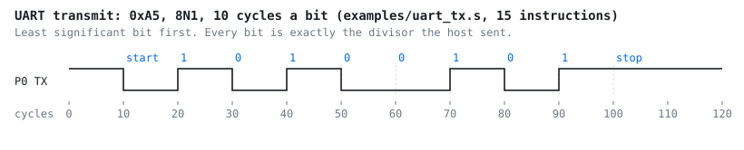
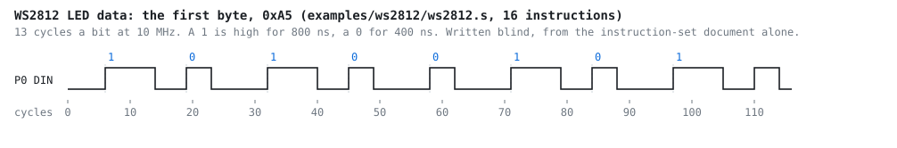

  

# protocol-emulator

An open-source protocol emulator ASIC for the
[Jane Street protocol emulator competition](https://blog.janestreet.com/protocol-emulator-asic-competition/):
a tiny CPU whose instructions read pins, write pins and count cycles, so UART,
SPI, I2C and 33 other protocols, 10 Mbit Ethernet among them, are
implemented in firmware loaded after fabrication rather than in fixed
logic. Written in Hardcaml, designed for tapeout through
[Tiny Tapeout](https://tinytapeout.com) on IHP 130nm CMOS5L (8x4 tiles).

> **This is v2.3.** Branches `v2.2`, `v2.1` and `v2` (v2.0) hold the
> earlier versions, each a complete chip, laid out and passing its own
> checks.

**In ten minutes:** [`docs/submission.md`](docs/submission.md) is the
one-page summary for judges. This page is the map.

## Status

- **Complete chip, laid out.** Two threads, each with 256 words of program
  memory in its own SRAM macro, a 1024-word packet buffer in a third, 8
  protocol pins (input, push-pull or open-drain each), loaded over an SPI
  host port. LVS and the Tiny Tapeout precheck pass, and timing is met at
  50 MHz at every corner ([`docs/metrics.md`](docs/metrics.md)).
- **39 protocols as firmware**, two running at a time. UART, SPI and I2C as
  required, in both roles for SPI and I2C; both stretch goals, low-speed
  USB as a host and 10 Mbit Ethernet, sending and receiving; JTAG, SWD,
  1-Wire, WS2812, PS/2 and CAN; I2S, DMX512, Wiegand, NEC and RC-5
  infrared, MDIO, DALI, PWM and a NES gamepad; Microwire, HDMI-CEC and
  RC-6 infrared. Twenty-two have firmware of their own. RC-6 is framed by
  the driver on an infrared burst sender that knows no code, and sixteen
  more (MIDI, LIN, Modbus RTU and thirteen devices on I2C and SPI) run on
  the other engines with framing in the host driver.
- **Hardware that did not need to know the protocols.** Nine engines were
  added to v1.4 with no RTL change. v2.0 changed one thing, the program
  memory, and eleven more engines followed, again with no RTL change.
- **Ethernet is where the hardware had to grow, and it grew by parts that
  are not Ethernet's.** A bit lasts four clocks, too few for a thread to
  fetch its data, compute a CRC or time an edge. So v2.1 added a packet
  buffer, automatic refill of the shift registers and a CRC register with
  a programmable polynomial, and v2.2 a bit sampler that recovers a
  sender's clock from samples on both clock edges. Each is configured by
  registers and used by firmware: the preamble, the Manchester code, the
  frame and its end are still programs, 70 instructions to send and 14 to
  receive.
- **CAN is a node.** It sends, with bit stuffing, CRC and arbitration done
  on the chip, and it receives: it checks each frame's CRC and
  acknowledges it. The receiver needed v2.3's three settings for the bit
  sampler (a prescaler, a pin shift, stuff-bit removal), none of them
  CAN's own. It sends no error frames.
- **Three formal proofs.** The whole chip, pins in to pins out, equals an
  independent specification; after every layout the gate netlist equals
  the RTL; and the memories those proofs assume equal IHP's own models of
  the SRAM macros.
- **Judged by tools this project did not write.** Device models by other
  people where one exists; for 37 tests the recorded pins go to sigrok's
  protocol decoders.
- **The real driver, unchanged**, runs against the chip in simulation and
  in MicroPython on an emulated demo board.
- **Not yet done:** no FPGA or silicon run; signoff warnings for slew and
  capacitance that are not yet explained; and an Ethernet receiver that
  stands less jitter than the standard asks, so it needs a short cable.
  The full list is "What is not shown" in
  [`docs/submission.md`](docs/submission.md).

## Architecture


[`docs/chip.html`](docs/chip.html) is a laid-out chip in 3D: every one of
the 101,866 cells where the tools placed it (17,925 of logic; the rest are
the fill and decoupling cells that pack the empty rows), coloured by its block,
with the reference model running real firmware in the page and lighting
the flip-flops that hold a 1. It shows the v1.4 layout, with the program
memory as the block of flip-flops that v2.0 replaced by two SRAM macros;
the layouts since have not been rendered yet. It is one self-contained file
with no network access: download it and open it in a browser, or
[view it here](https://htmlpreview.github.io/?https://github.com/tavelarocque/protocol-emulator/blob/main/docs/chip.html).

The instruction set ([`docs/isa.md`](docs/isa.md)) follows the RP2040's PIO:

- every instruction takes one cycle, plus a 0-15 cycle delay field
- side-set: up to 3 pins driven from the delay field alongside any instruction
- shift registers feed and drain 4-deep host FIFOs, by PUSH and PULL or,
  with autopull and autopush, by themselves as they empty and fill
- two threads, each with its own PC, registers, FIFOs, configuration and
  256-word program memory, both running every cycle; when both write a pin
  in the same cycle, thread 1 wins
- a jump reaches the 64 words of its page; a PAGE register per thread, set
  by `set page`, chooses which of the four pages that is
- a clock divider per thread, and CHAIN, which feeds thread 0's output
  straight into thread 1
- a two-flip-flop synchroniser on every protocol pin input, bypassable per
  pin for protocols too fast for the delay
- shift direction per thread, so MSB-first protocols (SPI, I2C) take and
  return plain bytes
- a CRC register per thread, 32 bits with any polynomial, that follows the
  bits a thread shifts out or in, one bit per instruction
- a packet buffer, 1024 words, that the host fills and sets playing into a
  thread's FIFO, or that records what a thread pushes, a word a cycle with
  no host in the way
- a bit sampler: clock recovery for one pin from samples on both clock
  edges, with its timing in registers, handing the threads recovered bits
  on two pins

Three programs as the reference model runs them, drawn from its output by
[`docs/figures.py`](docs/figures.py), which CI re-runs so the pictures cannot
drift from the firmware:






It departs from PIO where PIO is weakest for protocol emulation:

| | RP2040 PIO | This core |
|---|---|---|
| Waiting on a pin | blocks forever | optional timeout, jumps to a per-thread vector |
| I2C / open-drain | emulated by toggling pin direction | per-pin open-drain mode in hardware |
| Bit timing | fractional clock divider | counter loops, value supplied by the host at run time |
| Program loading | internal bus | SPI port, so any external host can load firmware |
| Undefined encodings | n/a | none: every 16-bit word is a defined instruction |
| Program memory | 32 words, shared by four state machines | 256 words per thread, in SRAM |
| CRC | in software on the host | a register per thread that follows the shifted bits |
| Data faster than the host | DMA in the microcontroller | a 1024-word buffer, played and recorded by the chip |
| Recovering a sender's clock | in the program, which needs many clocks to the bit | a bit sampler on both clock edges, for codes at four clocks to the bit |


Each revision of the instruction set came from writing a protocol and
finding what was missing; [`docs/firmware.md`](docs/firmware.md) has the
history.

## Protocols

Assembly for each is in [`examples/`](examples); descriptions and limits
are in [`docs/firmware.md`](docs/firmware.md). Each thread has 256 words;
the largest engine, Ethernet transmit, uses 70.

| Protocol | Role | Instructions | Checked against |
|---|---|---|---|
| UART | TX and RX, full duplex | 15 + 15 | cocotbext-uart |
| SPI | controller, to 5 Mbit/s | 26 | picosoc's SPI flash |
| SPI | device | 23 | cocotbext-spi's controller |
| I2C | controller, with stretching, timeouts and repeated START | 30 | cocotbext-i2c's EEPROM |
| I2C | target | 63 | cocotbext-i2c's controller, 400 kHz |
| JTAG | controller | 11 | cocotbext-jtag and an IEEE 1149.1 device |
| Arm SWD | host | 11 | a target written from ADIv5; sigrok's SWD decoder |
| USB, low speed | host | 49 | usbhostslave's device core; sigrok's USB decoders |
| 1-Wire | controller, with ROM search | 25 | sockit_owm's slave model, three on one wire; sigrok's 1-Wire decoders |
| 10BASE-T Ethernet | transmitter with link pulses, and receiver, 10 Mbit/s | 70 + 14 | a receiver and a sender written from IEEE 802.3, the sender's clock 100 ppm off and its edges jittered; `zlib`'s CRC-32 |
| WS2812 | driver | 16 | a hidden data-sheet timing test; sigrok's WS281x decoder |
| PS/2 | host, both directions | 11 + 21 | a device written from the protocol's rules; sigrok's PS/2 decoder |
| CAN | a node: a transmitter that stuffs the bits, makes the CRC and arbitrates, and a receiver that checks the CRC and acknowledges, all on the chip | 59 + 89 | a node written from ISO 11898-1; sigrok's CAN decoder |
| I2C to SPI | bridge, no host in the data path | 30 + 26 | the I2C and SPI oracles together |
| I2S | transmitter, 16-bit stereo | 11 | sigrok's I2S decoder |
| DMX512 | transmitter | 26 | sigrok's DMX512 decoder |
| Wiegand | transmitter and receiver | 17 + 16 | sigrok's Wiegand decoder; a reader written from the protocol's rules |
| NEC infrared | transmitter, 38 kHz carrier included; receiver | 25 + 33 | sigrok's NEC decoder; a remote written from the protocol's rules, 15% fast and slow |
| MDIO | controller, reads and writes | 7 | a PHY written from IEEE 802.3 clause 22; sigrok's MDIO decoder |
| DALI | controller: forward frames on one thread, and on the other a receiver, through the bit sampler, that reads the gear's answers | 17, 9 | sigrok's DALI decoder |
| RC-5 infrared | transmitter, 36 kHz carrier included; receiver, through the bit sampler | 37, 9 | sigrok's RC-5 decoder |
| PWM, RC servo | generator | 8 | sigrok's PWM decoder; exact to the cycle |
| NES gamepad | host | 7 | a pad's shift register written from its data sheet; sigrok's gamepad decoder |
| Microwire | controller, any number of bits; a 93C46 EEPROM on it | 10 | an EEPROM written from the datasheet; sigrok's Microwire and 93xx decoders |
| HDMI-CEC | initiator: sends messages, reads each block's acknowledgement, stops at a block that fails | 38 | a follower written from the specification's timing limits; sigrok's CEC decoder |
| RC-6 infrared | transmitter, 36 kHz carrier included, on a burst sender | 7, framing in the driver | a receiver written from RC-6's rules; sigrok's RC-6 decoder |
| MIDI | on the UART transmitter | no new firmware | sigrok's MIDI decoder |
| LIN | master frames, on the DMX512 transmitter | no new firmware | sigrok's LIN decoder |
| Modbus RTU | requests, on the UART transmitter | no new firmware | sigrok's Modbus decoder, which checks the CRC |
| 24Cxx EEPROM, DS1307 clock, LM75 sensor | on the I2C controller | no new firmware | sigrok's decoder for each; cocotbext-i2c's memory |
| SPI NOR flash, WS2801 LEDs | on the SPI controller | no new firmware | sigrok's decoder for each; picosoc's flash |
| MAX7219 | on the SPI controller | no new firmware | sigrok's MAX7219 decoder |
| nRF24L01, CC1101, RFM12 and MRF24J40 radios; ENC28J60 Ethernet controller; ADF435x synthesiser; SD card in SPI mode | on the SPI controller | no new firmware | sigrok's decoder for each, reading the commands sent and the bytes a scripted device answers |

The "checked against" models are other people's wherever one exists. For
SWD, PS/2 and CAN the device model is written here from the standard, so
the pins are also recorded and handed to sigrok's protocol decoders, which
this project did not write ([`test/sigrok.py`](test/sigrok.py)). Every
protocol from I2S down is judged the same way, by sigrok's decoder for it.
The USB, 1-Wire and WS2812 recordings go to sigrok as well, beside the
device models. In all but two of the 37 tests (DS1307 and PWM) one bit is
then forced on the recorded wire, and the decoder's verdict must change.
Ethernet has only the receiver and sender written here from the standard,
with the CRC-32 from `zlib`.

## Verification

[`docs/design-and-verification.md`](docs/design-and-verification.md) is the
report: design decisions and their alternatives, how the layers of evidence
chain into a claim about the chip, the real bugs found, and what is not
covered. [`docs/verification-layers.md`](docs/verification-layers.md) has
every layer and every planted bug, and [`docs/bug-ledger.md`](docs/bug-ledger.md)
tells thirteen real bugs and which layer found each.

The specification is executable: [`model/isa.ml`](model/isa.ml) is a
reference model with no dependency on the hardware, so the two cannot share
a bug.

| Question | Answer | How |
|---|---|---|
| Does the RTL match the specification? | Proven, for the whole chip | SAT equivalence (Hardcaml_verify + Z3) of one clock of the top level against an independent spec, for every state and every input |
| Does the silicon netlist match the RTL? | Proven, after every layout | Yosys equivalence over every output, all 1,107 flip-flops and every pin of the three memories ([`gl_equiv/`](gl_equiv)) |
| Is the memory in the proofs the memory on the chip? | Proven against IHP's models of the macros | Yosys: the flip-flop description the tests and proofs use, at both sizes, equals IHP's behavioural model of each SRAM, tied off as the chip ties it ([`formal/`](formal)). That the silicon macros match IHP's models is IHP's to guarantee |
| Is every instruction defined? | Yes, all 65,536 words | exhaustive round trips, and the spec's datapath matched on every word |
| Do the protocols work? | Each judged by an independent oracle | third-party device models and sigrok's decoders in cocotb, on the RTL and the gate netlist |
| Does the host driver work? | The same file, unchanged | in cocotb, then in MicroPython on an emulated board (rp2040js) wired to the RTL |
| Would the tests notice a bug? | 176 planted bugs, all caught | kept in the repo; the suite fails if one survives |
| Did the random tests reach everything? | Coverage is counted | any instruction, stall or timeout never seen fails the build |

Generated files cannot drift: CI regenerates the Verilog, the firmware
images, the example programs and the timing diagrams, and fails if a
committed copy differs.

The hardware has changed four times since v1.4: the program memory
(v2.0), the packet buffer, automatic refill and the CRC register (v2.1),
the bit sampler (v2.2), and three settings for it, a prescaler, a pin
shift and stuff-bit removal (v2.3). Each time the model, both independent
specifications, the proofs, the planted bugs and the coverage that the
build requires were extended first, and every earlier program still runs
unchanged. Everything else since v1.4 is firmware, testing and
documentation, none of which can put the chip at risk.

## Repository

```
hw/      Hardcaml RTL: pe_core (two threads and their memories, the packet
         buffer, the bit sampler), tiny_fifo, top (SPI port + registers)
model/   reference model, assembler, firmware, UART oracles (no dependency on hw/)
bin/     pe_sim: assemble a .s file, or run it on the reference model and print
         the pins as they change (`dune exec bin/pe_sim.exe -- run -help`);
         the Verilog, firmware-image and example generators
examples/ one assembly file per protocol, generated from model/firmware.ml;
         ws2812/: the blind firmware test, task, notes and hidden test
sim/     OCaml tests: ISA, lockstep harness, random and directed differential tests,
         formal proof, firmware, chip-level tests
host/    MicroPython driver for the demo board, RP2040 or RP2350 (tested in cocotb, unchanged,
         and in MicroPython on an emulated board: test/board_emu)
         more_protocols.py: the drivers for the protocols added since v2.0, a module of
         their own so that each fits the Pico's memory when compiled
src/     Verilog for Tiny Tapeout: project.v (pin map) + generated protocol_emulator.v;
         config.json, pdn_cfg.tcl and sram_bb.v place and power the SRAM macros
         (from Tiny Tapeout's SRAM example, Apache-2.0)
test/    cocotb testbench (RTL and gate-level) + generated firmware .hex;
         sram_model/ is IHP's behavioural models of the SRAM macros;
         usbhostslave/ is a third-party USB device core and onewire_slave_model.v
         a third-party 1-Wire device model (both LGPL, test only)
gl_equiv/ Yosys proof that the post-layout netlist equals the RTL (run in CI)
formal/  Yosys proof that the memories the tests and proofs use equal IHP's
         models of the SRAM macros (run in CI)
docs/    submission.md (one-page summary), design-and-verification.md (the report),
         figures.py and img/ (diagrams drawn from the reference model),
         chip.html (the layout in 3D, one self-contained page),
         isa.md (instruction set), firmware.md (every engine),
         verification-layers.md, bug-ledger.md, metrics.md,
         info.md (datasheet), coverage-closure.md, related-work.md
```

## Running

With the tools below installed, `./reproduce.sh` re-runs every check that
needs no layout build and prints one pass or fail line per claim (about 15
minutes for the OCaml suite and proofs, about 40 for the two memory
proofs, then about 25 for the cocotb suite).

Uses a dedicated opam switch on OCaml 5.3.0 (Hardcaml's waveform viewer does
not build on 5.4 yet).

```
opam switch create hardcaml ocaml-base-compiler.5.3.0
opam switch link hardcaml          # run inside this folder
eval $(opam env)
opam install hardcaml hardcaml_waveterm hardcaml_verify ppx_hardcaml ppx_jane core dune
dune build      # build, regenerate src/protocol_emulator.v and test/*.hex
dune runtest    # run the OCaml verification suite (formal proof needs z3: brew install z3)
dune promote    # accept expect-test output after checking the diff
```

The cocotb tests need Icarus Verilog and `pip install -r test/requirements.txt`,
then `cd test && make`. The RTL-to-netlist proof needs Yosys
(`pip install yowasp-yosys`), the netlist from a layout build's
`tt_submission` artifact and IHP's standard-cell Liberty file:
`python3 gl_equiv/check.py --netlist <netlist.v> --lib <cells.lib> --mutants --yosys yowasp-yosys`.
The board emulation needs Verilator and Node 22: `make -C test/board_emu`,
then `node run_usb.mjs` there (see `test/board_emu/README.md`).

## Metrics

The v2.3 layout, on Tiny Tapeout's ttihp27a flow (8x4 tiles, 20 ns
target): 14,837 standard cells and three SRAM macros, 23.8% utilisation,
0.75 m of wire, setup and hold met at every corner, LVS and the Tiny
Tapeout precheck passing, laid out in under 40 minutes. The firmware here
runs the chip at 10 MHz, 12 MHz for USB and 40 MHz for Ethernet. Slew and
capacitance warnings remain and are not yet explained. The comparison
with v1.4 and v2.0, the clock sweep and the warnings:
[`docs/metrics.md`](docs/metrics.md).
