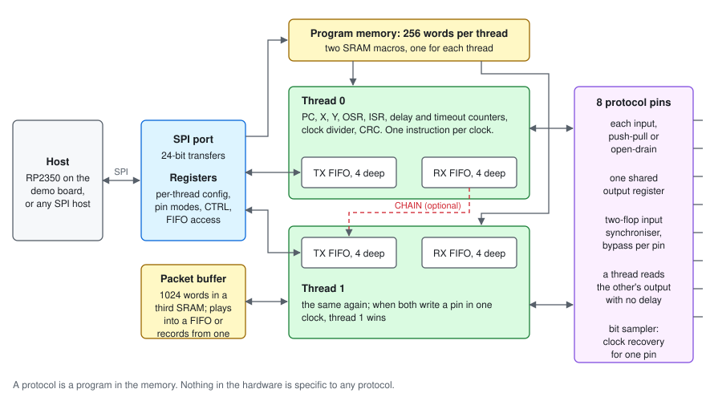
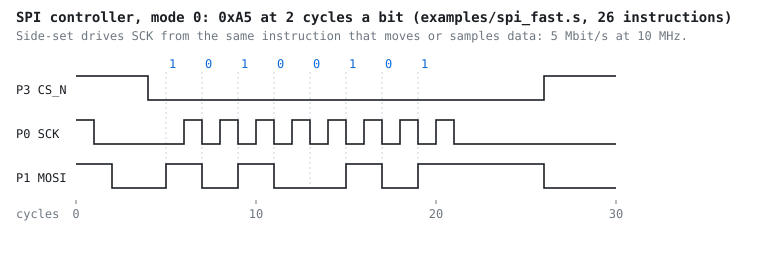

  

# protocol-emulator

Tave La Rocque

A programmable I/O chip for the
[Jane Street protocol emulator competition](https://blog.janestreet.com/protocol-emulator-asic-competition/):
a two-thread CPU in the style of the RP2040's PIO, whose instructions read
pins, write pins and count cycles, so every protocol it speaks is firmware
loaded over SPI at run time. Written in Hardcaml and designed for tapeout
through [Tiny Tapeout](https://tinytapeout.com) on IHP 130 nm CMOS5L (8x4
tiles). It passes the Tiny Tapeout precheck, and timing closes at 50 MHz at
every corner.

## Protocols nobody here chose

Can the chip be programmed for protocols it was not designed for? To answer
that without choosing the protocols, a census was run under rules pushed
before it started ([`flex/PREREG.md`](flex/PREREG.md)). Twenty protocols
were drawn from sigrok's decoder list, which this project did not write,
leaving out those the chip already had, in an order set by a public
randomness beacon. Each went to an AI agent in a fresh session that had
never seen the project, with only a task sheet,
[`docs/isa.md`](docs/isa.md) and the simulator. A hidden test it never saw
handed the recorded pins to sigrok's own decoder for that protocol and
checked the timing limits the decoder does not.

| Census | |
|---|---|
| Drawn | 20 |
| Out of reach: the Z80 and Intel 8048 memory buses need 11 and 14 parallel lines, and the chip has 8 protocol pins | 2 |
| Attempted | 18 |
| Passed, on the first and only hand-in | 18 of 18 |
| Predicted before the draw | 12 to 16 of 20 |
| Second question: the first 8 again, once on the full chip and twice each on chips without the delay field and without side-set | 40 of 40 pass |

Removing a feature never made a protocol impossible. Without the delay
field some programs doubled in length; without side-set one protocol that
moves two lines at once was 31 to 64 percent slower. The programmers were
AI agents, not people, and everything ran on the reference model. The
draw, every task sheet, hidden test and hand-in, and every departure from
the rules are in [`flex/RESULTS.md`](flex/RESULTS.md).

## What else runs

Apart from the census, 94 protocols run in this repository's chip-level
tests. **45 have firmware of their own.** Four more are framed by the
host driver on two senders that know no code (RC-6 on an infrared burst
sender; Qi, EM4100 and Morse on a sender of levels at a fixed rate). The
other 45 are device protocols, MIDI, LIN, Modbus RTU and 42 devices (a TPM
2.0 among them), on the I2C, SPI, Microwire, UART, 1-Wire, JTAG and MDIO
engines with the framing in the driver. Of the 120 chip-level tests, 92
hand the recorded pins to a protocol decoder this project did not write,
and in 90 of those a fault forced on the wire must change the decoder's
verdict. Every protocol and its judge is in the [table below](#protocols).

**In ten minutes:** [`docs/submission.md`](docs/submission.md) is the
summary for judges. This page is the map.

> **This is v2.3.** Branches `v2.2`, `v2.1` and `v2` (v2.0) hold the
> earlier versions, each a complete chip, laid out and passing its own
> checks.

## Status

- **Complete chip, laid out.** Two threads, each with 256 words of program
  memory in its own SRAM macro, a 1024-word packet buffer in a third, 8
  protocol pins (input, push-pull or open-drain each), loaded over an SPI
  host port. It passes LVS as well as the precheck; the layout's figures
  are under [Metrics](#metrics) and in [`docs/metrics.md`](docs/metrics.md).
- **Hardware that did not need to know the protocols.** Nine engines were
  added to v1.4 with no RTL change. v2.0 changed one thing, the program
  memory, and eleven more engines followed, again with no RTL change.
  The hardware has been frozen at v2.3 since, and 58 of the 94 protocols
  came after it, 25 of them with firmware of their own.
- **Ethernet is where the hardware had to grow, and it grew by parts that
  are not Ethernet's.** A bit lasts four clocks, too few for a thread to
  fetch its data, compute a CRC or time an edge. So v2.1 added a packet
  buffer, automatic refill of the shift registers and a CRC register with
  a programmable polynomial, and v2.2 a bit sampler that recovers a
  sender's clock from samples on both clock edges. Each is configured by
  registers and used by firmware: the preamble, the Manchester code, the
  frame and its end are still programs, 70 instructions to send and 14 to
  receive.
- **CAN is a node.** It sends, with bit stuffing, CRC and arbitration done
  on the chip, and it receives: it checks each frame's CRC and
  acknowledges it. The receiver needed v2.3's three settings for the bit
  sampler (a prescaler, a pin shift, stuff-bit removal), none of them
  CAN's own. It sends no error frames.
- **Three formal proofs.** The whole chip, pins in to pins out, equals an
  independent specification; after every layout the gate netlist equals
  the RTL; and the memories those proofs assume equal IHP's own models of
  the SRAM macros.
- **The real driver, unchanged**, runs against the chip in simulation and
  in MicroPython on an emulated demo board.
- **Not shown:** nothing has run on an FPGA or on silicon; and the
  Ethernet receiver stands less jitter than the standard asks, so it
  needs a short cable. The full list is "Limits" in
  [`docs/submission.md`](docs/submission.md).

## See it run

[`docs/demo.html`](docs/demo.html) replays eight recorded runs of the
reference model: UART, I2C with a device answering, CAN with a second
node, a whole Ethernet frame, step and direction, an RC servo, Morse code,
and two protocols at once. Each shows the pins as a logic analyser would,
the firmware listing, and a drawing of the bench those pins would be
wired to. Every run is checked when the page is built, and the build
fails if a check does. It is simulation only: nothing here has run on
hardware. It is one self-contained file with no network access: download
it and open it in a browser, or
[view it here](https://htmlpreview.github.io/?https://github.com/tavelarocque/protocol-emulator/blob/main/docs/demo.html).
[`docs/playground.html`](docs/playground.html) lets you edit the firmware
and run it: the reference model and the assembler compiled to JavaScript,
in the page, also one file with no network access
([open it here](https://tavelarocque.github.io/protocol-emulator/playground.html)).

## Architecture



[`docs/chip.html`](docs/chip.html) is a laid-out chip in 3D: every one of
the 101,866 cells where the tools placed it (17,925 of logic; the rest are
the fill and decoupling cells that pack the empty rows), coloured by its block,
with the reference model running real firmware in the page and lighting
the flip-flops that hold a 1. It shows the v1.4 layout, with the program
memory as the block of flip-flops that v2.0 replaced by two SRAM macros;
the layouts since have not been rendered yet. It is one self-contained file
with no network access: download it and open it in a browser, or
[view it here](https://htmlpreview.github.io/?https://github.com/tavelarocque/protocol-emulator/blob/main/docs/chip.html).

The instruction set ([`docs/isa.md`](docs/isa.md)) follows the RP2040's PIO:

- every instruction takes one cycle, plus a 0-15 cycle delay field
- side-set: up to 3 pins driven from the delay field alongside any instruction
- shift registers feed and drain 4-deep host FIFOs, by PUSH and PULL or,
  with autopull and autopush, by themselves as they empty and fill
- two threads, each with its own PC, registers, FIFOs, configuration and
  256-word program memory, both running every cycle; when both write a pin
  in the same cycle, thread 1 wins
- a jump reaches the 64 words of its page; a PAGE register per thread, set
  by `set page`, chooses which of the four pages that is
- a clock divider per thread, and CHAIN, which feeds thread 0's output
  straight into thread 1
- a two-flip-flop synchroniser on every protocol pin input, bypassable per
  pin for protocols too fast for the delay
- shift direction per thread, so MSB-first protocols (SPI, I2C) take and
  return plain bytes
- a CRC register per thread, 32 bits with any polynomial, that follows the
  bits a thread shifts out or in, one bit per instruction
- a packet buffer, 1024 words, that the host fills and sets playing into a
  thread's FIFO, or that records what a thread pushes, a word a cycle with
  no host in the way
- a bit sampler: clock recovery for one pin from samples on both clock
  edges, with its timing in registers, handing the threads recovered bits
  on two pins

Three programs as the reference model runs them, drawn from its output by
[`docs/figures.py`](docs/figures.py), which CI re-runs so the pictures cannot
drift from the firmware:





It departs from PIO where PIO is weakest for protocol emulation:

| | RP2040 PIO | This core |
|---|---|---|
| Waiting on a pin | blocks forever | optional timeout, jumps to a per-thread vector |
| I2C / open-drain | emulated by toggling pin direction | per-pin open-drain mode in hardware |
| Bit timing | fractional clock divider | counter loops, value supplied by the host at run time |
| Program loading | internal bus | SPI port, so any external host can load firmware |
| Undefined encodings | n/a | none: every 16-bit word is a defined instruction |
| Program memory | 32 words, shared by four state machines | 256 words per thread, in SRAM |
| CRC | in software on the host | a register per thread that follows the shifted bits |
| Data faster than the host | DMA in the microcontroller | a 1024-word buffer, played and recorded by the chip |
| Recovering a sender's clock | in the program, which needs many clocks to the bit | a bit sampler on both clock edges, for codes at four clocks to the bit |


Each revision of the instruction set came from writing a protocol and
finding what was missing; [`docs/firmware.md`](docs/firmware.md) has the
history.

## Protocols

Assembly for each is in [`examples/`](examples); descriptions and limits
are in [`docs/firmware.md`](docs/firmware.md). Each thread has 256 words;
the largest engine, the MVB train bus, uses 112, and Ethernet transmit 70.
The 18 census protocols are not in this table: their programs, task
sheets and hidden tests are in [`flex/census/`](flex/census), and they ran
on the reference model only.

| Protocol | Role | Instructions | Checked against |
|---|---|---|---|
| UART | TX and RX, full duplex | 15 + 15 | cocotbext-uart |
| SPI | controller, to 5 Mbit/s | 26 | picosoc's SPI flash |
| SPI | device | 23 | cocotbext-spi's controller |
| I2C | controller, with stretching, timeouts and repeated START | 30 | cocotbext-i2c's EEPROM |
| I2C | target | 63 | cocotbext-i2c's controller, 400 kHz |
| JTAG | controller | 11 | cocotbext-jtag and an IEEE 1149.1 device |
| Arm SWD | host | 11 | a target written from ADIv5; sigrok's SWD decoder |
| USB, low speed | host | 49 | usbhostslave's device core; sigrok's USB decoders |
| 1-Wire | controller, with ROM search | 25 | sockit_owm's slave model, three on one wire; sigrok's 1-Wire decoders |
| 10BASE-T Ethernet | transmitter with link pulses, and receiver, 10 Mbit/s | 70 + 14 | a receiver and a sender written from IEEE 802.3, the sender's clock 100 ppm off and its edges jittered; `zlib`'s CRC-32 |
| WS2812 | driver | 16 | a hidden data-sheet timing test; sigrok's WS281x decoder |
| PS/2 | host, both directions | 11 + 21 | a device written from the protocol's rules; sigrok's PS/2 decoder |
| CAN | a node: a transmitter that stuffs the bits, makes the CRC and arbitrates, and a receiver that checks the CRC and acknowledges, all on the chip | 59 + 89 | a node written from ISO 11898-1; sigrok's CAN decoder |
| I2C to SPI | bridge, no host in the data path | 30 + 26 | the I2C and SPI oracles together |
| I2S | transmitter, 16-bit stereo | 11 | sigrok's I2S decoder |
| DMX512 | transmitter | 26 | sigrok's DMX512 decoder |
| Wiegand | transmitter and receiver | 17 + 16 | sigrok's Wiegand decoder; a reader written from the protocol's rules |
| NEC infrared | transmitter, 38 kHz carrier included; receiver | 25 + 33 | sigrok's NEC decoder; a remote written from the protocol's rules, 15% fast and slow |
| MDIO | controller, reads and writes | 7 | a PHY written from IEEE 802.3 clause 22; sigrok's MDIO decoder |
| DALI | controller: forward frames on one thread, and on the other a receiver, through the bit sampler, that reads the gear's answers | 17, 9 | sigrok's DALI decoder |
| RC-5 infrared | transmitter, 36 kHz carrier included; receiver, through the bit sampler | 37, 9 | sigrok's RC-5 decoder |
| PWM, RC servo | generator | 8 | sigrok's PWM decoder; exact to the cycle |
| NES gamepad | host | 7 | a pad's shift register written from its data sheet; sigrok's gamepad decoder |
| Microwire | controller, any number of bits; a 93C46 EEPROM on it | 10 | an EEPROM written from the datasheet; sigrok's Microwire and 93xx decoders |
| HDMI-CEC | initiator: sends messages, reads each block's acknowledgement, stops at a block that fails | 38 | a follower written from the specification's timing limits; sigrok's CEC decoder |
| RC-6 infrared | transmitter, 36 kHz carrier included, on a burst sender | 7, framing in the driver | a receiver written from RC-6's rules; sigrok's RC-6 decoder |
| Step and direction | for stepper motor drivers: moves and ramps, every step exact to the tick | 10 | a DRV8825's inputs written from its timing table; sigrok's stepper motor decoder |
| AM2302 / DHT22, DHT11 | reader: start pulse, 40 bits told apart by their length, and a flag if the sensor stops answering | 27 | a sensor written from the datasheet, at every timing it allows; sigrok's AM230x decoder |
| TDM audio | transmitter, any number of 16-bit slots to a frame | 18 | a codec's receiving side written from the format's rules; sigrok's TDM decoder |
| TLC5620 DAC | its four-wire interface: clocked data, LOAD and LDAC | 12 | the DAC's digital side written from its datasheet; sigrok's TLC5620 decoder |
| Qi | the packets a power receiver sends a charger, on a sender of levels at a fixed rate | 3, framing in the driver | a demodulator written from Qi's rules; sigrok's Qi decoder |
| EM4100 | a tag's 64 bits, on the same sender | no new firmware | a reader written from the tag's rules; sigrok's EM4100 decoder |
| Morse | on the same sender | no new firmware | a listener written from the code's rules; sigrok's Morse decoder |
| MIDI | on the UART transmitter | no new firmware | sigrok's MIDI decoder |
| LIN | master frames, on the DMX512 transmitter | no new firmware | sigrok's LIN decoder |
| Modbus RTU | requests, on the UART transmitter | no new firmware | sigrok's Modbus decoder, which checks the CRC |
| 24Cxx EEPROM, DS1307 clock, LM75 sensor | on the I2C controller | no new firmware | sigrok's decoder for each; cocotbext-i2c's memory |
| RTC-8564 clock, TCA6408A port expander, MXC6225XU accelerometer, a monitor's EDID | on the I2C controller, each read through a repeated START | no new firmware | sigrok's decoder for each; cocotbext-i2c's memory |
| SPI NOR flash, WS2801 LEDs | on the SPI controller | no new firmware | sigrok's decoder for each; picosoc's flash |
| MAX7219 | on the SPI controller | no new firmware | sigrok's MAX7219 decoder |
| nRF24L01, CC1101, RFM12 and MRF24J40 radios; ENC28J60 Ethernet controller; ADF435x synthesiser; SD card in SPI mode | on the SPI controller | no new firmware | sigrok's decoder for each, reading the commands sent and the bytes a scripted device answers |
| ATSHA204A crypto chip (wake, a Read command with its CRC-16, sleep), PCA9571 port expander | on the I2C controller | no new firmware | each part written from its data sheet as a cocotbext-i2c device; sigrok's decoder for each |
| XFP optical module (identifier and alarm thresholds); HDCP's handshake on an HDMI link (Bcaps, An, Aksv, Bksv, Ri', with no cipher) | on the I2C controller, through a repeated START | no new firmware | cocotbext-i2c's memory laid out as the part's map; sigrok's decoder for each |
| CFP optical module's ID registers | on the MDIO controller, in clause 45 frames the driver builds | no new firmware | a clause 45 device written from IEEE 802.3 and the CFP agreement; sigrok's MDIO and CFP decoders |
| AVR in-system programming of an ATmega168 (enable, signature, fuses) | on the SPI controller, RESET on a fourth pin | no new firmware | the part written from its data sheet; sigrok's AVR ISP decoder |
| ADE7758 energy meter (register writes and reads); X2444M NOVRAM (writes and store; its reads answer on an edge the controller does not sample) | on the Microwire controller | no new firmware | each part written from its data sheet; sigrok's decoder for each |
| PAN1321 Bluetooth module's AT commands; an Amulet display's ASCII protocol | on the UART, both ways | no new firmware | each device scripted from its manual, answering; sigrok's decoder for each |
| ARM ITM trace over SWO, bare and inside TPIU frames | on the UART transmitter | no new firmware | a TPIU formatter written from ARM CoreSight; sigrok's ITM and TPIU decoders |
| DS2408 switch, DS2432 EEPROM, DS28EA00 thermometer | on the 1-Wire controller | no new firmware | each part's commands written from its data sheet, on sockit_owm's slave model; sigrok's decoder for each |
| An STM32's boundary-scan TAP and Cortex-M3 debug port, chained; a MIPS EJTAG session | on the JTAG controller | no new firmware | each TAP written from IEEE 1149.1 and the part's manual; sigrok's decoder for each (for EJTAG, its instruction and processor-access rows: its register rows label the scan before) |
| nRF905 radio, AD5626 DAC, AD7920 ADC, LTC2422 ADC | on the SPI controllers | no new firmware | each part written from its data sheet; sigrok's newer decoder for each |
| LTC2607 DAC (with its global address), MCP23017 port expander | on the I2C controller | no new firmware | each part written from its data sheet as a cocotbext-i2c device; sigrok's newer decoder for each |
| TI SDQ: a BQ2022A's ROM and memory | on the 1-Wire controller, whose timing SDQ shares | no new firmware | the part scripted from TI's data sheet; sigrok's newer SDQ decoder |
| SBUS (radio control receiver to flight controller) | transmitter, the line inverted | 22 | a receiver written from SBUS's rules; sigrok's newer SBUS decoder |
| DShot (flight controller to ESC) | transmitter, DShot600 | 19 | a DShot decoder published by hyp0dermik |
| XY2-100 (laser galvanometer scanners) | controller, both axes at 2 MHz | 17 + 20 | sigrok's newer XY2-100 decoder |
| Digital caliper data port | the caliper | 21 | sigrok's newer caliper decoder |
| MIPI I3C, SDR | controller with ENTDAA, SCL at 2 MHz, SDA open-drain throughout | 63 | four targets written from the I3C Basic specification; an I3C decoder published by xyphro |
| SAE J2716 SENT (automotive sensors) | transmitter, 3 us tick | 59 | a SENT decoder published by enp6s0 |
| SAE J1850 VPW (OBD-II) | transmitter, 10.4 kbit/s | 55 | sigrok's newer J1850 VPW decoder, and the CRC checked here |
| Sony SIRC infrared | transmitter, with carrier | 40 | sigrok's newer SIRC decoder |
| SLE 4442 memory card | reader | 40 | the card written from its data sheet; sigrok's newer SLE44xx decoder |
| Compact JTAG (IEEE 1149.7) | probe, OScan1 | 55 | a target written from IEEE 1149.7; sigrok's newer cJTAG decoder |
| PJON over PJDL | sender, any of PJDL's modes | 56 | sigrok's newer PJDL and PJON decoders |
| NXP LFAST with SIPI | sender, 5 Mbit/s at 50 MHz | 33 | sigrok's newer LFAST and SIPI decoders |
| MIL-STD-1553B | bus controller at 1 Mbit/s, with a second thread reading every word back | 53 + 23 | a remote terminal written from the standard; sigrok's 1553 decoder from pull request #28 |
| ARINC 429 | sender, 100 kbit/s | 38 | two ARINC 429 decoders, by Aleksandr-Kai and by FrancescoTalotta |
| SpaceWire | sender, data and strobe, 2 Mbit/s here, 10 at 50 MHz | 45 + 13 | sigrok's SpaceWire decoder from pull request #82 |
| ISO 7816-3 smart card | reader, with the card's clock on the other thread | 62 + 2 | a card written from ISO 7816-3; two ISO 7816 decoders, by svenso and by arthursimas1 |
| TPM 2.0 over SPI (TCG TIS) | on the SPI controller, wait states polled in one selection | no new firmware | the TPM written from the TCG specifications; sigrok's TPM decoders from pull request #88, and ghecko's |
| KNX TP1 | sender that reads the receiver's ACK | 63 | a device written from the TP1 rules; two KNX decoders, by mwalle and by the selfbus project |
| MVB (IEC 61375 train bus) | master and slave frames, 1.5 Mbit/s | 112 | a receiver written from published descriptions (the standard's text was not available); yeckel's MVB decoder |
| SMPTE linear timecode | sender, 25 frames a second | 78 | sigrok's timecode decoder from pull request #136 |

The "checked against" models are other people's wherever one exists. For
SWD, PS/2 and CAN the device model is written here from the standard, so
the pins are also recorded and handed to sigrok's protocol decoders, which
this project did not write ([`test/sigrok.py`](test/sigrok.py)). Every
protocol from I2S down is judged the same way, by sigrok's decoder for it.
The USB, 1-Wire and WS2812 recordings go to sigrok as well, beside the
device models. In all but two of the 92 tests (DS1307 and PWM) one bit is
then forced on the recorded wire, and the decoder's verdict must change.
Twenty-seven of those protocols are judged by decoders the packaged
sigrok-cli 0.7.2 does not ship: sixteen from sigrok's own newer source,
four from sigrok pull requests not yet merged (MIL-STD-1553, SpaceWire,
TPM over SPI, SMPTE timecode), and the rest published by others (SENT,
DShot, I3C, ISO 7816, ARINC 429, KNX, MVB, with a second decoder for the
smart card, ARINC 429, KNX and the TPM; a test must pass both). These are
less reviewed than sigrok's own, and where one misreads a correct
waveform the test's docstring says how.
[`test/extra_decoders.sh`](test/extra_decoders.sh) fetches each at a fixed
commit for the tests; none is copied into this repository.
Ethernet has only the receiver and sender written here from the standard,
with the CRC-32 from `zlib`.

## Verification

[`docs/design-and-verification.md`](docs/design-and-verification.md) is the
report: design decisions and their alternatives, how the layers of evidence
chain into a claim about the chip, the real bugs found, and what is not
covered. [`docs/verification-layers.md`](docs/verification-layers.md) has
every layer and every planted bug, and [`docs/bug-ledger.md`](docs/bug-ledger.md)
tells thirteen real bugs and which layer found each.

The specification is executable: [`model/isa.ml`](model/isa.ml) is a
reference model with no dependency on the hardware, so the two cannot share
a bug.

| Question | Answer | How |
|---|---|---|
| Does the RTL match the specification? | Proven, for the whole chip | SAT equivalence (Hardcaml_verify + Z3) of one clock of the top level against an independent spec, for every state and every input |
| Does the gate netlist match the RTL? | Proven, after every layout | Yosys equivalence over every output, all 1,107 flip-flops and every pin of the three memories ([`gl_equiv/`](gl_equiv)) |
| Is the memory in the proofs the memory on the chip? | Proven against IHP's models of the macros | Yosys: the flip-flop description the tests and proofs use, at both sizes, equals IHP's behavioural model of each SRAM, tied off as the chip ties it ([`formal/`](formal)). That the silicon macros match IHP's models is IHP's to guarantee |
| Is every instruction defined? | Yes, all 65,536 words | exhaustive round trips, and the spec's datapath matched on every word |
| Do the protocols work? | Each judged by an independent oracle | third-party device models and sigrok's decoders in cocotb, on the RTL and the gate netlist |
| Does the host driver work? | The same file, unchanged | in cocotb, then in MicroPython on an emulated board (rp2040js) wired to the RTL |
| Would the tests notice a bug? | 400 planted bugs, all caught | kept in the repo; the suite fails if one survives |
| Did the random tests reach everything? | Coverage is counted | any instruction, stall or timeout never seen fails the build |

Generated files cannot drift: CI regenerates the Verilog, the firmware
images, the example programs and the timing diagrams, and fails if a
committed copy differs.

The hardware has changed four times since v1.4: the program memory
(v2.0), the packet buffer, automatic refill and the CRC register (v2.1),
the bit sampler (v2.2), and three settings for it, a prescaler, a pin
shift and stuff-bit removal (v2.3). Each time the model, both independent
specifications, the proofs, the planted bugs and the coverage that the
build requires were extended first, and every earlier program still runs
unchanged. Everything else since v1.4 is firmware, testing and
documentation, none of which can put the chip at risk.

## Repository

```
hw/      Hardcaml RTL: pe_core (two threads and their memories, the packet
         buffer, the bit sampler), tiny_fifo, top (SPI port + registers)
model/   reference model, assembler, firmware, UART oracles (no dependency on hw/)
bin/     pe_sim: assemble a .s file, or run it on the reference model and print
         the pins as they change (`dune exec bin/pe_sim.exe -- run -help`);
         the Verilog, firmware-image and example generators;
         demo_traces: records and checks the runs shown in docs/demo.html
demo/    the demo page's template and bench drawing; vendor/ holds three.js (MIT)
         and the IBM Plex fonts (SIL OFL 1.1), both built into the page
examples/ one assembly file per protocol, generated from model/firmware.ml;
         ws2812/: the blind firmware test, task, notes and hidden test
sim/     OCaml tests: ISA, lockstep harness, random and directed differential tests,
         formal proof, firmware, chip-level tests
host/    MicroPython driver for the demo board, RP2040 or RP2350 (tested in cocotb, unchanged,
         and in MicroPython on an emulated board: test/board_emu)
         protocol_emulator.py is the driver; more_protocols.py and the other
         *_protocols.py files hold the drivers for the protocols added since v2.0,
         modules of their own so that each fits the Pico's memory when compiled
src/     Verilog for Tiny Tapeout: project.v (pin map) + generated protocol_emulator.v;
         config.json, pdn_cfg.tcl and sram_bb.v place and power the SRAM macros
         (from Tiny Tapeout's SRAM example, Apache-2.0)
test/    cocotb testbench (RTL and gate-level) + generated firmware .hex;
         sram_model/ is IHP's behavioural models of the SRAM macros;
         usbhostslave/ is a third-party USB device core and onewire_slave_model.v
         a third-party 1-Wire device model (both LGPL, test only)
gl_equiv/ Yosys proof that the post-layout netlist equals the RTL (run in CI)
formal/  Yosys proof that the memories the tests and proofs use equal IHP's
         models of the SRAM macros (run in CI)
flex/    the flexibility census: PREREG.md (its rules, pushed first), RESULTS.md,
         census/ (every task sheet, hidden test and hand-in), pilot/
docs/    submission.md (the summary for judges), design-and-verification.md (the report),
         figures.py and img/ (diagrams drawn from the reference model),
         chip.html (the layout in 3D, one self-contained page),
         demo.html (firmware running on recorded pins, one self-contained page),
         isa.md (instruction set), firmware.md (every engine),
         verification-layers.md, bug-ledger.md, metrics.md,
         info.md (datasheet), coverage-closure.md, related-work.md
```

## Running

With the tools below installed, `./reproduce.sh` re-runs every check that
needs no layout build and prints one pass or fail line per claim (about 15
minutes for the OCaml suite and proofs, about 40 for the two memory
proofs, then about 25 for the cocotb suite).

Uses a dedicated opam switch on OCaml 5.3.0 (Hardcaml's waveform viewer does
not build on 5.4 yet).

```
opam switch create hardcaml ocaml-base-compiler.5.3.0
opam switch link hardcaml          # run inside this folder
eval $(opam env)
opam install hardcaml hardcaml_waveterm hardcaml_verify ppx_hardcaml ppx_jane core dune
dune build      # build, regenerate src/protocol_emulator.v and test/*.hex
dune runtest    # run the OCaml verification suite (formal proof needs z3: brew install z3)
dune promote    # accept expect-test output after checking the diff
```

The cocotb tests need Icarus Verilog and `pip install -r test/requirements.txt`,
then `cd test && make`. The RTL-to-netlist proof needs Yosys
(`pip install yowasp-yosys`), the netlist from a layout build's
`tt_submission` artifact and IHP's standard-cell Liberty file:
`python3 gl_equiv/check.py --netlist <netlist.v> --lib <cells.lib> --mutants --yosys yowasp-yosys`.
The board emulation needs Verilator and Node 22: `make -C test/board_emu`,
then `node run_usb.mjs` there (see `test/board_emu/README.md`).

## Metrics

The v2.3 layout, on Tiny Tapeout's ttihp27a flow (8x4 tiles, 20 ns
target): 15,065 standard cells and three SRAM macros, 23.8% utilisation
at floorplanning, 0.76 m of wire, setup and hold met at every corner with
1.24 ns to spare at the slow one, no slew or capacitance violations, LVS
and the Tiny Tapeout precheck passing, laid out in about 70 minutes. Most
chip-level tests clock the chip at 10 MHz; USB runs at 12 MHz, Ethernet at
40, MVB at 48 and LFAST at 50, and KNX and SMPTE timecode below 10. The comparison with v1.4 and v2.0, the clock sweep, and the
signoff warnings of the earlier layouts, what caused them and what
repairing them cost: [`docs/metrics.md`](docs/metrics.md).
