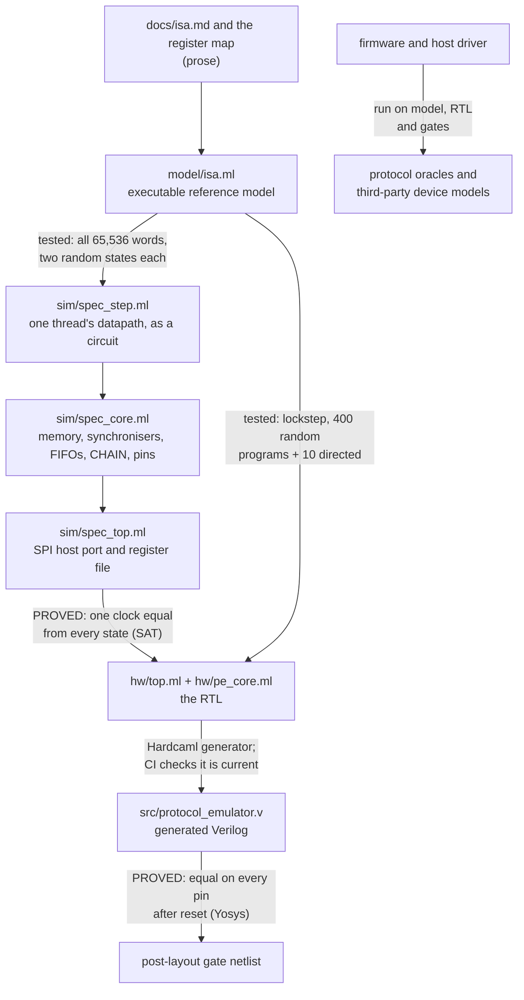

# Design and verification report

This report sets out why the chip should work when it comes back from the
foundry. For each part of the argument it names the layer of evidence behind
it and the classes of bug that layer can and cannot catch. It ends with what
is not covered. The README lists what exists; this document is the argument
that connects those pieces. The instruction set is in
[`isa.md`](isa.md), the datasheet in [`info.md`](info.md), and the
AI-assisted coverage work in [`coverage-closure.md`](coverage-closure.md).

## 1. The claims

| # | Claim | Main evidence | Strength |
|---|---|---|---|
| C1 | The RTL does what the instruction set and register map say, in every state, including states no test reaches | SAT equivalence proof of the whole chip against an independent spec; the spec checked against the reference model | Proof, for the RTL. The spec's agreement with the reference model is tested, not proven (section 3) |
| C2 | The firmware implements each protocol correctly at the pins | Protocol oracles on the model and the RTL; device models written by other people from real datasheets and standards | Tests, judged by independent oracles |
| C3 | The gate-level netlist behaves like the RTL | Formal equivalence of the post-layout netlist and the generated Verilog (Yosys, in CI after every layout); the cocotb suite rerun on the netlist; LVS | Proof, from the first cycle after a reset, on every output pin; Hardcaml's Verilog generation itself is trusted (section 7) |
| C4 | The chip meets timing at its rated 10 MHz | Static timing analysis at 50 MHz, slow corner | About 80 ns of slack at 10 MHz. At 50 MHz, the slow corner's slack has varied by 1.3 ns between layout runs of the same logic (−0.14 ns, then +1.19 ns), so 50 MHz is not claimed |
| C5 | A real host can drive it | The demo board's MicroPython driver, run unchanged against the chip in cocotb | Tests in simulation; not yet run on hardware |

## 2. Design

### The problem

The competition asks for a chip that speaks UART, SPI and I2C, with
low-speed USB and 10 Mbit Ethernet as stretch goals, on 6x4 Tiny Tapeout
tiles in IHP 130 nm. The approach here: make the protocols firmware rather
than gates. A fixed-function design has to be right about every protocol at
tapeout. A programmable one has to be right about one small CPU, after which
protocols can be added, fixed and tested in simulation for as long as
anyone likes.

### Decisions and their alternatives

| Decision | Alternative considered | Why |
|---|---|---|
| A PIO-style core (one instruction per clock, delay field, side-set, shift registers into FIFOs) | Fixed UART/SPI/I2C blocks; a small general-purpose CPU bit-banging pins | Fixed blocks cannot learn a protocol after fabrication. A general CPU has variable-latency instructions and branches, so cycle-exact timing is hard to read from the source. In a PIO-style core, the cycle count can be read from the program text |
| Waits with a timeout and a jump vector | PIO's wait, which blocks forever | A wedged bus (a device holding SCL low) must not hang the chip. I2C devices may stretch for milliseconds, so the timeout has its own 16-bit counter rather than borrowing X or Y (ISA v1, found by writing the I2C controller) |
| Open-drain as a per-pin mode | PIO's trick of toggling pin direction | I2C, SWD and any shared line need it, and a mode bit is cheaper in instructions and harder to get wrong |
| Every 16-bit word decodes to a defined instruction | Reserved encodings that trap or are undefined | Makes uniformly random program memory a valid test input and the decoder exhaustively checkable (65,536 words). There are no X states to reason about |
| Integer clock divider per thread | PIO's fractional divider | Simpler hardware. Fractional baud rates use X/Y loops instead; UART RX tolerates a sender about 5% off rate on isolated frames, and back-to-back frames are tested to 2% |
| Two threads sharing a 64-word memory (the model always had two) | Four, as PIO has | Two cover the useful pairings (TX+RX, controller+bridge). Layout time is already tight: two-thread layouts take 4 to 5 hours against GitHub's 6-hour job limit, where the one-thread v1.1 took 91 minutes, and one two-thread build ran out of time in routing |
| SPI host port, 24-bit transactions | A UART or a parallel bus | Any microcontroller can drive SPI, and the demo board's RP2040 can bit-bang it from MicroPython |
| Two-flip-flop synchronisers on every protocol input, bypassable per pin | No synchronisers | Found in a review for silicon, which simulation cannot find (ISA v1.3). The bypass exists because side-set SPI samples MISO one clock after SCK falls, and a test shows it fails with the extra two cycles |
| Shift direction per thread | Bit-reversal in the host | MSB-first protocols (SPI, I2C) take and return plain bytes, and one thread can bridge an MSB-first protocol into an LSB-first one |
| Freeze the hardware at v1.4 | Keep adding features | Every later change is firmware, tests or docs, so none of it can put the tapeout at risk |

Each ISA revision came from building something that did not fit. The I2C
controller needed more than 32 words and a longer timeout (v1). SPI needed
side-set to get from 9 cycles a bit to 2 (v1.1). The I2C-to-SPI bridge
needed a divider, because delay loops were a third of the I2C controller,
and CHAIN, so the host could leave the data path (v1.2). The silicon review
found the missing synchronisers (v1.3). The bit-reversal wart led to the
shift direction (v1.4). [`isa.md`](isa.md) records each one.

### The architecture's test: protocols added after the freeze

The design claim is that the hardware does not need to know the protocols.
The freeze put that claim to the test. Since v1.4, with no hardware change:

| Added after the freeze | Size | What it needed from the ISA |
|---|---|---|
| I2C target (the chip as a 7-bit-address device, with clock stretching and repeated START) | 63 words | open-drain; side-set holding SCL low while a FIFO stalls (clock stretching for free); waits with a zero timeout used as branches on a pin |
| SPI device, mode 0 | 23 words | a zero-timeout wait on the select line every bit, used as a branch, so a transfer cut mid-byte is noticed |
| JTAG controller (any TMS/TDI sequence, TDO back) | 11 words | `out pins, 2`, side-set for TCK |
| Arm SWD clock engine, with the framing in the host driver | 11 words | open-drain SWDIO, side-set for SWCLK |
| Host driver for the demo board | 482 lines of MicroPython | the register map only |

None of these is mentioned in the ISA's design or its revisions, which were
driven by the controllers. That they fit is the strongest evidence that the
instruction set is general enough. The I2C target and SPI device are driven
by controllers written by other people (cocotbext-i2c, cocotbext-spi); the
JTAG controller's scans are decoded by a third-party monitor
(cocotbext-jtag); SWD is checked only against a target written for this
project.

## 3. How the evidence chains



**The proof.** Hardcaml_verify cuts both circuits at their registers, pairs
the registers by name, and asks Z3 whether any state and any input make the
next state or an output differ. UNSAT means that one clock of the RTL equals
one clock of the spec from every state, reachable or not. For each pair of
registers the checker also compares the clear, clear value, reset value and
enable (Hardcaml_verify's `sec.ml`), so the two sides provably reset to the
same state. By induction, every run from reset is identical on every pin,
for any length and any input. That is stronger than any
amount of simulation, but only as strong as the spec.

**How independent the spec is.** The spec logic is written separately from
the RTL logic, from `docs/isa.md`, the reference model, and the protocol and
register map documented in `hw/top.ml`'s header comment, and in a different
style. The register map is a table that drives both writes and reads. Reads
are an OR of one-hot terms rather than an indexed multiplexer, and next
states are plain equations rather than an `Always` block. The two sides do
share more than logic-free facts: the checker needs register names, widths,
reset values and the FIFO's state encoding to pair them, the SPI port's
state is held in the same form, and the specs import the RTL's interface
types and constants (port records, the thread state record, the pin count).
A bug in a shared interface definition would be on both sides.

**Why the proof is not vacuous.** A proof that cannot fail proves nothing,
so the suite plants bugs and requires each to break it. All 10 planted RTL
bugs come back SAT with a counterexample. So do 3 bugs planted in the specs
themselves (CHAIN ignoring a full FIFO, STATUS levels swapped, RX popped by a
write), which shows the spec's own logic is being compared, not mirrored. A
fourth spec candidate, popping an empty RX FIFO, came back UNSAT. The proof
was right: the FIFO ignores that pop, so it was never a bug.

**Where the chain is a test, not a proof.** The reference model is OCaml
software, not a circuit, so the solver cannot reason about it. Two links
therefore rest on testing:

- The spec datapath against the model: every one of the 65,536 instruction
  words, each from two random states with random inputs and configuration.
  Exhaustive over instructions, sampled over states.
- The composed spec against the model: covered indirectly. The lockstep test
  compares the RTL with the model every cycle, and the RTL is proven equal to
  the spec, so any disagreement between the spec and the model on a lockstep
  run would show up there.

The lockstep test runs 400 random two-thread programs for 300 cycles each,
with random configurations, pins, host traffic and enables. Coverage counts
fail the build if any instruction outcome, stall, timeout or FIFO extreme
never occurs. Sixteen cross bins (two threads on one pin, CHAIN in the same
cycle as a pull, a wait expiring on a divided thread, and so on) are closed
by 10 directed scenarios.

**Firmware.** The protocols are judged at the pins, on the model, the RTL
and the gate netlist. Oracles written for this project (cycle-exact UART
waveform and receiver, an off-rate frame generator, I2C bus checker, SPI
mode-0 checker) catch timing that a receiver would forgive. Device models
written by other people from real standards catch misreadings shared by the
firmware and those oracles:

- picosoc's SPI flash;
- cocotbext-i2c's EEPROM and I2C controller;
- cocotbext-uart;
- cocotbext-spi's controller;
- cocotbext-jtag's monitor, which decodes every scan on the wires.

Two device models were written for this project because no third-party one
fits: the JTAG device (`test/jtag_tap.v`, IEEE 1149.1) and the SWD target
(`test/swd_dp.v`, Arm ADIv5). JTAG still has the third-party monitor as a
check on the wire protocol; SWD has nothing third-party, so its tests share
an author with the driver, which is a weaker check.

**From the RTL to the gates.** After every layout, CI proves the
post-layout netlist equal to the generated Verilog (`gl_equiv/`, Yosys).
Every flip-flop in the netlist keeps its RTL register's name, so the two
sides are paired by name: 1,840 pairs, every output pin and every one of the
netlist's 1,796 flip-flops. A pairing is only a candidate invariant; a wrong
one makes the proof fail, never pass. Two proofs then cover every run from
reset:

- base case: from any state, after one clock with `rst_n` low, every pair
  agrees, for any inputs (a SAT proof over two cycles);
- induction step: if every pair agrees in one cycle, every pair agrees in
  the next, for any state and any inputs (`equiv_induct`).

So from the first cycle after a reset, the netlist and the RTL drive the same
value on every output pin, whatever the inputs. The base case can rest on one
reset cycle because every register in the generated Verilog has a
synchronous clear: all 151 register blocks begin with it. Four bugs planted
in the netlist must each break the proof: a NAND turned into a NOR, a
flip-flop held in reset, two flip-flops' inputs crossed (all three break the
induction step), and a flip-flop that comes out of reset with the wrong
value (breaks the base case). Tiny Tapeout's own action set has an `eqy`
check of this kind for its Sky130 process only; this one is adapted to IHP's
cells.

## 4. Which layer catches which bug

| Bug class | Example | Caught by | Cannot be caught by |
|---|---|---|---|
| Wrong instruction semantics in the RTL | X never decrements | the proof (every state); lockstep (within 16 programs) | protocol tests, unless the firmware happens to use that path |
| Two threads interacting wrongly | pin priority inverted; CHAIN into a full FIFO | the whole-core proof; lockstep with cross bins | the datapath-only proof in general: it shares the composition logic on both sides, so it refutes the planted composition bugs only because they are planted on one side |
| Host port or register map | STATUS bits swapped | the whole-chip proof; cocotb register tests | the core proof |
| RTL and spec agree, both misread the ISA document | (none found) | lockstep against the reference model, which was written separately | the proof |
| Firmware timing | a stop bit one clock short; SDA moved before SCL falls | cycle-exact oracles; bus checkers | a forgiving receiver: a real UART receiver caught the bring-up's short stop bit in 13 of 300 cases, and the firmware's short start bit in none (`sim/test_uart_tx.ml`, `sim/test_isa.ml`) |
| Firmware and project oracles share a misreading of a protocol | (none found) | third-party device models | the project's own oracles |
| Corner cases a typical controller never produces | an I2C controller with zero data hold time | spec-derived reference controllers swept across speed and hold time | any controller with ordinary data hold time |
| Synthesis or layout | a mis-synthesised mux; a flip-flop stuck in reset | the RTL-to-netlist proof; gate-level cocotb suite; LVS | every OCaml test (they see only the RTL) |
| Timing | a long path at the slow corner | static timing analysis | all simulation |
| Metastability on asynchronous inputs | an unsynchronised pin read | design review; synchronisers by construction | all simulation, and the proof (the model is synchronous) |
| Host driver | pin modes packed one bit per pin | the driver run unchanged against the chip in cocotb | every test that drives the chip with its own code |

The rows marked "(none found)" are layers that have so far only been tested
with planted bugs. Section 5 lists the layers that found real ones.

## 5. Testing the tests

### Planted bugs

Every layer keeps its planted bugs in the repository as code, and the suite
fails if any survives. There are 47 in all:

| Layer | Planted bugs | Where |
|---|---:|---|
| core RTL | 10 | `Pe_core.Mutation`: lockstep and both core proofs |
| specs | 3 | `Spec_top.Plant`, `Spec_core`: the proofs |
| UART bring-up | 3 | `sim/test_uart_tx.ml` |
| UART TX firmware | 2 | `sim/test_isa.ml` |
| SPI host port | 1 | `Top.Mutation`: the whole-chip proof and `sim/test_top.ml` |
| SPI controller firmware | 1 | `sim/test_spi_fw.ml` |
| SPI device firmware | 5 | `sim/test_spi_target.ml` |
| I2C controller firmware | 2 | `sim/test_i2c_fw.ml` |
| I2C target firmware | 6 | `sim/test_i2c_target.ml` |
| JTAG firmware | 3 | `sim/test_jtag.ml` |
| SWD firmware | 3 | `sim/test_swd.ml` |
| JTAG, SWD and host drivers | 4 | `test_driver_planted_bugs` in `test/test.py` |
| gate netlist | 4 | `gl_equiv/check.py`: the RTL-to-netlist proof |

The driver bugs are planted by replacing one driver method for one
scenario. The same test first runs each scenario with the real driver and
requires it to pass, so a scenario that fails for some other reason cannot
count as a catch. The SPI host-port bug is a parameter of `hw/top.ml`, off
by default, following `hw/pe_core.ml`; the generated Verilog is
byte-identical with or without the parameter in the source.

All 47 are caught. Two candidates turned out not to be bugs, and the
reasons are informative:

- Popping an empty RX FIFO: the proof showed the FIFO ignores that pop.
- SWCLK left high a clock longer: SWD targets act only after rising edges,
  so the protocol is unaffected. It was replaced by a bug that matters,
  SWDIO changing in the same clock as SWCLK rises. That bug forced a
  setup-time check into the SWD tests.

Planted bugs are only as good as the imagination behind them. The I2C target
bug "SCL checked before SDA when watching for STOP" survived every
controller with normal data hold time. It was caught only after a sweep with
a controller that moves SDA in the same clock as SCL falls, which the I2C
specification allows. The firmware now reads SDA first.

### Real bugs found

| What was wrong | Found by |
|---|---|
| SCK idled high after reset (pins reset high; SPI mode 0 needs it low) | SPI mode-0 checker |
| UART RX waited for idle after every frame, losing back-to-back frames from a sender 1.7% fast | off-rate frame generator |
| Protocol pins had no input synchronisers | a review for silicon; no simulation could show it |
| Side-set SPI returned wrong bytes once synchronisers delayed MISO | a test; fixed with the per-pin bypass |
| The I2C controller did not fit in 32 words, and a timeout held in Y could not outlast half a bit | writing the firmware (ISA v1) |
| The harness started the model's synchroniser from a different state than the hardware | lockstep, on cycle 0 |
| "PUSH stalls on a full RX FIFO" never happened in random testing | functional coverage failing the build |
| An AI-written scenario ran phase-locked and never hit the bins it claimed | the closure check |
| No directed scenario caught a synchroniser bug | the closure check (requires every planted bug caught) |
| The project's SPI slave model dropped a preloaded response on deselect; the I2C checker was too strict about the edge before STOP | the oracles disagreeing with the firmware, with the oracle at fault |
| The first v1.4 build missed 50 MHz by 0.14 ns at the slow corner | static timing analysis |

## 6. AI-assisted verification, and independence

This project was built with an AI assistant (Claude), and the commits say
so. That raises a fair question: if one author writes the RTL, the spec, the
firmware and the tests, can one misreading pass every layer? Four rules
answer it.

1. **The AI proposes stimulus; it never decides what is correct.** In
   coverage closure, the assistant read the cross-coverage report and wrote
   directed scenarios. The reference model judged every cycle, and closure
   checks rejected any scenario that missed its own targets. One was
   rejected that way.
2. **Correctness rests on artefacts written separately.** The reference
   model has no dependency on the hardware. The specs were written from the
   documents in a different style, and share only what the checker needs.
3. **Device models written by other people.** Every protocol except SWD is
   checked against at least one device model written by someone else, from
   the real datasheet or standard. They are the backstop against a shared
   misreading, and they do not know this project exists.
4. **Every check is shown to fail.** Planted bugs, kept in the repository
   as code, show each layer can fail (section 5). One caveat from
   [`coverage-closure.md`](coverage-closure.md) applies: the bug-targeted
   scenarios were written by the same assistant that planted the bugs. The
   coverage-targeted scenarios are measured by the model's own counts and do
   not have that problem.

## 7. What is not covered

- **Hardcaml's Verilog generator is trusted.** The core proofs are on the
  Hardcaml circuit and the netlist proof starts from the generated Verilog;
  the step between them is Hardcaml's own, checked only by CI regenerating
  the Verilog and failing if the committed copy differs, and by every
  simulation running on that Verilog.
- **Below the netlist, the PDK is trusted.** The netlist proof takes each
  cell's logic from IHP's Liberty file. LVS checks the layout against the
  netlist; that each cell's transistors compute its Liberty function is
  IHP's to guarantee.
- **The spec against the reference model** is tested over all instruction
  words but sampled over states (section 3).
- **Metastability** is handled by design: two-flip-flop synchronisers on
  every protocol input and on the host port. A pin with SYNC_BYPASS set is
  the firmware author's responsibility. The host port requires each SCK
  phase to last at least 4 core clocks.
- **Timing.** The chip is rated at 10 MHz. At 50 MHz, the slow corner
  (1.08 V, 125 °C) missed by 0.14 ns in the first v1.4 build and met it with
  1.19 ns to spare in the current one, with no change in logic: placement
  varies between layout runs, so 50 MHz is not claimed.
- **Pads, reset and power** are Tiny Tapeout's and are not modelled beyond
  the gate-level simulation.
- **Hardware.** Nothing has run on silicon yet. The host driver has run in
  CPython against the simulated chip, not yet in MicroPython on the demo
  board's RP2040, where bit-banging will be slower and is unverified.
- **Speed limits** are measured in simulation. The I2C target keeps up with
  SCL low for 7 core clocks; the SPI device with 8 clocks per SCK phase
  (625 kHz at 10 MHz).
- **Protocols not done.** CAN, low-speed USB and 10 Mbit Ethernet. A USB
  low-speed bit is about 6.7 core clocks at 10 MHz, which side-set makes
  conceivable but untried.
- **SWD's target model** was written for this project, from ADIv5, so it does
  not give the independence a third-party model would.

## 8. Reproducing

```
dune build      # regenerate the Verilog and the firmware images
dune runtest    # OCaml suite: ISA, lockstep, coverage closure, formal proofs,
                # firmware, chip-level tests (the proofs need z3)
cd test && make # cocotb suite on the RTL (Icarus Verilog)
python3 gl_equiv/check.py --netlist <netlist.v> --lib <cells.lib> --mutants
                # RTL-to-netlist proof (Yosys), on a layout build's netlist
```

The setup is in the [README](../README.md). In recent GitHub Actions runs
the OCaml suite took about 16 minutes and the cocotb suite under 2. The
layout itself takes 4 to 5 hours; the whole workflow, with the precheck and
the gate-level rerun, took 6 to 7. The RTL-to-netlist proof with its four
planted bugs takes about 7 minutes on two cores.
