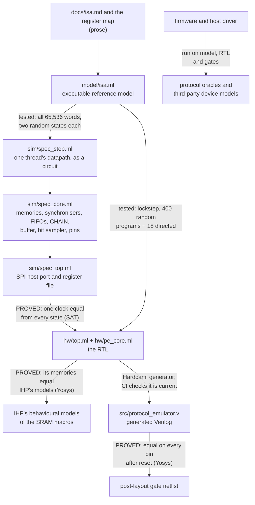

# Design and verification report

This report sets out why the chip should work when it comes back from the
foundry. For each part of the argument it names the layer of evidence behind
it and the classes of bug that layer can and cannot catch. It ends with what
is not covered. The README lists what exists; this document is the argument
that connects those pieces. The instruction set is in
[`isa.md`](isa.md), the datasheet in [`info.md`](info.md), and the
AI-assisted coverage work in [`coverage-closure.md`](coverage-closure.md).

## 1. The claims

| # | Claim | Main evidence | Strength |
|---|---|---|---|
| C1 | The RTL does what the instruction set and register map say, in every state, including states no test reaches | SAT equivalence proof of the whole chip against an independent spec; the spec checked against the reference model | Proof, for the RTL. The spec's agreement with the reference model is tested, not proven (section 3) |
| C2 | The firmware implements each protocol correctly at the pins | Protocol oracles on the model and the RTL; device models written by other people from real datasheets and standards | Tests, judged by independent oracles |
| C3 | The gate-level netlist behaves like the RTL | Formal equivalence of the post-layout netlist and the generated Verilog (Yosys, in CI after every layout); the cocotb suite rerun on the netlist; LVS | Proof, from the first cycle after a reset, on every output pin and every pin of the three memories, whatever the memories hold; Hardcaml's Verilog generation and the SRAM macro itself are trusted (section 7) |
| C4 | The chip meets timing at the 10 MHz the firmware runs it at (12 MHz for USB, 40 MHz for Ethernet), with room to 50 MHz | Static timing analysis of the 8x4 layout at a 20 ns target (50 MHz), three corners | Setup and hold met at every corner. Slew and capacitance warnings stand at all three corners and are not yet explained (section 7). The Ethernet tests clock the chip at 40 MHz, but no simulation here has gate delays in it, so the speed rests on static timing analysis alone |
| C5 | A real host can drive it | The demo board's MicroPython driver, run unchanged against the chip in cocotb, and in MicroPython on an emulated demo board (rp2040js running Tiny Tapeout's firmware) wired to the RTL: UART, I2C, SPI, JTAG, SWD and USB against the same devices (1-Wire's driver runs there on a simulated bus; PS/2 and CAN do not run there yet; the drivers added since v2.0 run there against a chip that only records what it is asked, and must ask the same as under CPython) | Tests in simulation and emulation; not yet run on hardware |

## 2. Design

### The problem

The competition asks for a chip that speaks UART, SPI and I2C, with
low-speed USB and 10 Mbit Ethernet as stretch goals, on up to 8x4 Tiny
Tapeout tiles in IHP 130 nm. The approach here: make the protocols firmware rather
than gates. A fixed-function design has to be right about every protocol at
tapeout. A programmable one has to be right about one small CPU, after which
protocols can be added, fixed and tested in simulation for as long as
anyone likes.

### Decisions and their alternatives

| Decision | Alternative considered | Why |
|---|---|---|
| A PIO-style core (one instruction per clock, delay field, side-set, shift registers into FIFOs) | Fixed UART/SPI/I2C blocks; a small general-purpose CPU bit-banging pins | Fixed blocks cannot learn a protocol after fabrication. A general CPU has variable-latency instructions and branches, so cycle-exact timing is hard to read from the source. In a PIO-style core, the cycle count can be read from the program text |
| Waits with a timeout and a jump vector | PIO's wait, which blocks forever | A wedged bus (a device holding SCL low) must not hang the chip. I2C devices may stretch for milliseconds, so the timeout has its own 16-bit counter rather than borrowing X or Y (ISA v1, found by writing the I2C controller) |
| Open-drain as a per-pin mode | PIO's trick of toggling pin direction | I2C, SWD and any shared line need it, and a mode bit is cheaper in instructions and harder to get wrong |
| Every 16-bit word decodes to a defined instruction | Reserved encodings that trap or are undefined | Makes uniformly random program memory a valid test input and the decoder exhaustively checkable (65,536 words). There are no X states to reason about |
| Integer clock divider per thread | PIO's fractional divider | Simpler hardware. Fractional baud rates use X/Y loops instead; UART RX tolerates a sender about 5% off rate on isolated frames, and back-to-back frames are tested to 2% |
| Two threads (the model always had two) | Four, as PIO has | Two cover the useful pairings (TX+RX, controller+bridge). Layout time was the constraint when this was decided: two-thread layouts on 6x4 tiles took 4 to 5 hours against GitHub's 6-hour job limit, where the one-thread v1.1 took 91 minutes |
| Program memory in SRAM macros, 256 words per thread (v2.0) | v1.4's 64 words of flip-flops shared by both threads; a larger flip-flop memory | A flip-flop memory could not grow: 256 words placed and then could not be routed, and 128 did not finish in GitHub's 6 hours either ([`metrics.md`](metrics.md)). An SRAM macro of 256 words is 2% of the die. It reads one word a clock, so each thread has its own. The chip came out smaller and faster: 10,359 cells against 17,925, laid out in 20 to 30 minutes |
| A PAGE register for jumps (v2.0) | Widening the jump address | `jmp` holds 6 bits and every 16-bit word is already a defined instruction. A page register, set by an encoding that was a NOP until then, leaves every v1.4 program encoding and running as before |
| A packet buffer in a third SRAM, which the chip plays into a thread's FIFO or records from one, a word a cycle (v2.1) | Deeper FIFOs; a faster host port | An Ethernet frame is up to 12,144 bits with no pause, 625,000 words a second, and the host port moves about 260,000 at 50 MHz. FIFOs deep enough for a frame would be a memory anyway. A buffer that only moves words into and out of the FIFOs the threads already have leaves every instruction as it was, and serves any protocol whose data outruns the host |
| Autopull and autopush: a shift register that refills or empties itself (v2.1) | PULL and PUSH instructions, as every engine before used | At four clocks a bit there is no cycle to spend fetching a word. Off unless a thread's configuration asks for it |
| A CRC register per thread with the polynomial, start value and inversion in registers, taking one bit for each shift instruction (v2.1) | The CRC in the host driver, as USB's still is and CAN's was; a CRC-32 block for Ethernet alone; a register taking a whole word a cycle | The judges ask for the CRC on the chip. A register with a programmable polynomial serves every serial CRC: the tests confirm the published check values of CRC-32, CRC-16/USB and CRC-15/CAN. One bit per instruction is how a serial protocol shifts anyway, and the version that took 16 bits a cycle made the datapath proof run for minutes without finishing; this one proves in about one |
| A bit sampler: clock recovery for one pin, in hardware, from samples on both clock edges (v2.2) | Clock recovery in firmware, as the USB engine does it; a fixed Ethernet receiver | Low-speed USB has 8 clocks to the bit. 10 Mbit Ethernet at 40 MHz has 4, and at some alignments of the two clocks 4 samples a bit leave no margin at all. Both edges give 8. The block does the timing and waits for a sync word, and nothing else: its three timing numbers are registers, so it recovers other Manchester and NRZ codes, and the frame is still firmware's. It changes no instruction: the threads see the recovered bit and a pulse on two pins |
| Three settings for the sampler: a prescaler, a pin shift and stuff-bit removal (v2.3) | A CAN receiver in firmware alone; a CAN block | A CAN node must decide whether a frame was good within one bit of its last CRC bit, and acknowledge. A thread decoding the bus alone needs every path through the decoder to take the same number of ticks, with four registers to hold a run length, a field count, a level and the data. With the sampler taking one sample every n clocks, a thread on the same divider sees one pulse for each bit; with the stuff bits already taken out, the bits it counts are the frame's; with the recovered bit moved off the pin it listens to, the thread can also read the line itself. None of the three knows what CAN is: the run length is a register, so the same setting serves any code that stuffs after n equal bits at either level. A code that stuffs after ones only, as USB does, it does not serve. All three are off after reset |
| SPI host port, 24-bit transactions | A UART or a parallel bus | Any microcontroller can drive SPI: the demo board's RP2350 (or the older boards' RP2040) can bit-bang it from MicroPython, or run it from PIO where timing matters (USB) |
| Two-flip-flop synchronisers on every protocol input, bypassable per pin | No synchronisers | Found in a review for silicon, which simulation cannot find (ISA v1.3). The bypass exists because side-set SPI samples MISO one clock after SCK falls, and a test shows it fails with the extra two cycles |
| Shift direction per thread | Bit-reversal in the host | MSB-first protocols (SPI, I2C) take and return plain bytes, and one thread can bridge an MSB-first protocol into an LSB-first one |
| Freeze the hardware at v1.4, and change it only when a protocol cannot be done without it: the memory (v2.0), the buffer and CRC register (v2.1), the bit sampler (v2.2) and three settings for it (v2.3) | Keep adding features | Every other change is firmware, tests or docs, so none of it can put the tapeout at risk. Each hardware change is off by default, leaves every earlier program running unchanged, and went in with its model, specifications, proofs and planted bugs. v2.0, v2.1 and v2.2 stay on their branches, laid out and passing, as fallbacks |

Each ISA revision came from building something that did not fit. The I2C
controller needed more than 32 words and a longer timeout (v1). SPI needed
side-set to get from 9 cycles a bit to 2 (v1.1). The I2C-to-SPI bridge
needed a divider, because delay loops were a third of the I2C controller,
and CHAIN, so the host could leave the data path (v1.2). The silicon review
found the missing synchronisers (v1.3). The bit-reversal wart led to the
shift direction (v1.4). The I2C target, at 63 of the 64 words, left no
room for anything beside it, and a CAN node that acknowledges did not fit
at all, which led to the SRAM (v2.0). Ethernet, which this report used
to list under what the architecture could not do, needed its data, its CRC
and its bit timing faster than a thread or the host could supply them,
which led to the packet buffer, the refill and the CRC register (v2.1) and
the bit sampler (v2.2). A CAN node, which this report also used to list
under what was not done, needed a frame's bits one to a tick with the
stuff bits gone, which led to the sampler's prescaler, pin shift and
stuff-bit removal (v2.3). [`isa.md`](isa.md) records each one.

### The architecture's test: protocols added after the freeze

The design claim is that the hardware does not need to know the protocols.
The freeze put that claim to the test. Since v1.4, with no hardware change:

| Added after the freeze | Size | What it needed from the ISA |
|---|---|---|
| I2C target (the chip as a 7-bit-address device, with clock stretching and repeated START) | 63 words | open-drain; side-set holding SCL low while a FIFO stalls (clock stretching for free); waits with a zero timeout used as branches on a pin |
| SPI device, mode 0 | 23 words | a zero-timeout wait on the select line every bit, used as a branch, so a transfer cut mid-byte is noticed |
| JTAG controller (any TMS/TDI sequence, TDO back) | 11 words | `out pins, 2`, side-set for TCK |
| Arm SWD clock engine, with the framing in the host driver | 11 words | open-drain SWDIO, side-set for SWCLK |
| Low-speed USB host engine (the competition's stretch goal): sends packets with EOP and turnaround, receives with clock recovery | 49 words, plus the 5-word echo as a relay | timed waits on the edge that would leave the current level, the timeout vector as "no edge this bit"; CHAIN to buffer a whole transaction on either side of the engine; side-set for the transceiver's FSE0 and OE_N |
| WS2812 LED driver, written blind: by an AI agent given only `docs/isa.md`, the simulator and the LEDs' timing, never the repository; it passed a hidden data-sheet timing test on its first submission (`examples/ws2812`) | 16 words | side-set on P0, 13-cycle bits; the host sends each frame's bit count first so the firmware ends it with a 310 us latch |
| 1-Wire bus engine (reset and presence, read and write time slots), with the ROM commands, ROM search and CRC8 in the host driver: a protocol the chip was not designed for, added once the hardware was finished | 25 words | open-drain DQ; CLKDIV set to the core clock in MHz so a tick is 1 us, and Y loops of 16 us for the long waits; a slot that writes a 1 and samples is a read, so one 8-instruction slot does both |
| PS/2 host for keyboards and mice: a receiver that never stops listening on one thread, a transmitter on the other; added after 1-Wire, on the same finished hardware | 11 + 21 words | open-drain DATA and CLK; wait timeouts to abandon a frame the device gave up; a spare pin driven by the receiver's side-set and read by the transmitter's `wait`, so that one thread tells the other a frame is under way |
| CAN: a transmitter that arbitrates and reads the ACK slot, and a listen-only receiver. Since v2.1's CRC register the transmitter makes the whole frame: bit stuffing and CRC-15 on the chip. Since v2.3's sampler settings the receiver is a node's: it checks the CRC and acknowledges (it sends no error frames) | 19 + 27 words on v1.4; 59 + 89 as a node | a wait with a zero timeout as the branch that reads the bus after every recessive bit sent; a timed wait as the watch for the edge to resynchronise on; `mov osr, isr` and an OUT with the other shift direction to branch on the bit just recorded. In the transmitter: the last level sent is which of two loops it is in, the run of equal bits is the ISR's shift count, and stuff bits are written without an OUT, so the CRC register never sees them. In the receiver: the sampler's pulse is the bit clock, the CRC register left at zero is the verdict, a timed wait on the line itself finds the gap between frames, and TXD read at one bit of the frame tells its own frames from another node's |
| Host driver for the demo board | 1,277 lines of MicroPython | the register map only; for USB, a 7-instruction PIO program (RP2040 or RP2350) that runs the host port |

None of these is mentioned in the ISA's design or its revisions, which were
driven by the controllers. That they fit is the strongest evidence that the
instruction set is general enough. The I2C target and SPI device are driven
by controllers written by other people (cocotbext-i2c, cocotbext-spi); the
JTAG controller's scans are decoded by a third-party monitor
(cocotbext-jtag); the USB host reads a descriptor from a third-party USB
device core (usbhostslave); SWD, PS/2 and CAN are checked only against
devices written for this project, from Arm's ADIv5, the PS/2 protocol's
rules and ISO 11898-1.

**The same test again, on v2.0.** v2.0 changed the program memory and
nothing else about how instructions execute. Eleven more engines were then
written with no RTL change:

| Added on v2.0 | Size | What it used |
|---|---|---|
| I2S transmitter, 16-bit stereo | 11 words | side-set for the bit clock and word select; the next sample fetched inside the last bit, so the clock never stretches |
| DMX512 transmitter | 26 words | the input shift register's bit counter as the break timer, the only counter left free |
| Wiegand transmitter and receiver | 17, 16 words | equal-length paths so pulses stay 1 ms apart across a word boundary; the receiver copies all eight pins and peels off two, to see both lines in one clock |
| NEC infrared transmitter and receiver | 25, 33 words | the 38 kHz carrier made in firmware; in the receiver, timed waits whose timeout vector means "the frame was cut short" |
| RC-5 infrared transmitter | 37 words | a look one bit ahead, so two bursts that meet are one unbroken burst |
| RC-5 infrared receiver (on v2.3) | 9 words | the bit sampler as Ethernet uses it, 20 samples to a bit of 1.778 ms through the prescaler; a wait's timeout as "the transmission was cut short" |
| MDIO controller | 7 words | open-drain data; one loop serves reads and writes, since each word shifted out comes back as the word read meanwhile |
| DALI forward frame transmitter | 17 words | the bit loop written twice, once for each level the bus may hold while the next bit is fetched |
| DALI receiver (on v2.3) | 9 words | a frame begins on an edge between bits, so the sampler cannot lock to the middles: it takes every edge and a sample every half bit, and the driver pairs the halves. The count that ends a frame's words is told from data because the sampler never passes more than three equal half bits |
| PWM and RC servo pulses | 8 words | the two counts kept in the two shift registers, leaving X to count |
| NES gamepad | 7 words | side-set for latch and clock |
| Microwire controller | 10 words | chip select active high and transfers of any number of bits, which is why SPI's engines do not serve; the bit read on a clock is the device's answer to that clock |
| HDMI-CEC initiator | 38 words | every path through a bit the same number of ticks; the ACK bit read 1.0 ms after its edge; a message that fails ends there, and the blocks still queued for it are taken from the FIFO unsent |
| Infrared burst sender | 7 words | bursts and silences as whole carrier periods, counted from the host's word; it knows no code, so RC-6 is framed by the driver |
| Drivers for all of these | 931 lines of MicroPython, a second file | the register map only |

Sixteen further protocols needed no firmware: MIDI and Modbus RTU on the
UART transmitter, LIN on the DMX512 transmitter (a UART that can send a
break), 24Cxx EEPROMs, the DS1307 clock and the LM75 sensor on the I2C
controller, and ten devices on the SPI controller: NOR flash, WS2801 LEDs,
the MAX7219, the nRF24L01, CC1101, RFM12 and MRF24J40 radios, the ENC28J60
Ethernet controller, the ADF435x synthesiser and an SD card in SPI mode.
Four more devices came once the I2C controller could send a repeated
START, each read the way its data sheet shows: the RTC-8564 clock, the
TCA6408A port expander, the MXC6225XU accelerometer and a monitor's EDID.
Each of these protocols, and the three engines that came after
(Microwire, HDMI-CEC, RC-6), is judged by sigrok's decoder for it,
which this project did not write. For the last seven the device is a
script of the bytes the part would answer, not a model of the part: the
decoder judges the commands the chip sent and reads the answers off the
wire, and the test checks the controller read the same bytes. The two
receivers have no outside judge: their sources are written here, from
the protocols' rules.

**Ethernet: where the hardware had to change.** Every protocol before it
fitted the frozen hardware. 10 Mbit Ethernet did not, and what matters is
how little of it ended up in gates. The four additions are a memory, a
refill rule, a CRC register and a clock-recovery block; none of them knows
what a preamble, a Manchester cell or a frame is.

| Part of 10BASE-T | Done by |
|---|---|
| Preamble and start delimiter, sent | firmware: a counted loop |
| Manchester coding, sent | firmware: side-set, four clocks a bit |
| The frame's data at 10 Mbit/s | the packet buffer, played into the FIFO |
| CRC-32, sent | the CRC register; firmware moves it into the shift register after the last data bit |
| CRC-32, checked | the CRC register follows the received bits; the host compares what is left in it with one constant |
| Start of idle | firmware |
| Link pulses between frames, 100 ns every 16 ms | firmware: ten waits that time out, then a pulse |
| Clock recovery and Manchester decoding, received | the bit sampler |
| Finding the start of the frame | the bit sampler's sync word, set to 0xD5 by the host |
| Taking the bits, counting them, finding the end | firmware: one IN per bit, a wait with a timeout |
| Storing the frame | the packet buffer, recording |

The transmitter is 70 instructions, the first program longer than a page,
and the receiver 14. Apart from `mov` to and from the CRC register, both
use only instructions that existed before. What Ethernet does not have is an outside judge: the receiver that checks
the transmitter and the sender that feeds the receiver are written here
from IEEE 802.3, and only the CRC-32 they check with is someone else's
(`zlib`).

## 3. How the evidence chains



**The proof.** Hardcaml_verify cuts both circuits at their registers, pairs
the registers by name, and asks Z3 whether any state and any input make the
next state or an output differ. UNSAT means that one clock of the RTL equals
one clock of the spec from every state, reachable or not. For each pair of
registers the checker also compares the clear, clear value, reset value and
enable (Hardcaml_verify's `sec.ml`), so the two sides provably reset to the
same state. By induction, every run from reset is identical on every pin,
for any length and any input. That is stronger than any
amount of simulation, but only as strong as the spec.

**How independent the spec is.** The spec logic is written separately from
the RTL logic, from `docs/isa.md`, the reference model, and the protocol and
register map documented in `hw/top.ml`'s header comment, and in a different
style. The register map is a table that drives both writes and reads. Reads
are an OR of one-hot terms rather than an indexed multiplexer, and next
states are plain equations rather than an `Always` block. The two sides do
share more than logic-free facts: the checker needs register names, widths,
reset values and the FIFO's state encoding to pair them, the SPI port's
state is held in the same form, and the specs import the RTL's interface
types and constants (port records, the thread state record, the pin count).
A bug in a shared interface definition would be on both sides.

**Why the proof is not vacuous.** A proof that cannot fail proves nothing,
so the suite plants bugs and requires each to break it. All 33 planted RTL
bugs come back SAT with a counterexample, and so do the 2 planted in the
host port and register file. So do 3 bugs planted in the specs
themselves (CHAIN ignoring a full FIFO, STATUS levels swapped, RX popped by a
write), which shows the spec's own logic is being compared, not mirrored. A
fourth spec candidate, popping an empty RX FIFO, came back UNSAT. The proof
was right: the FIFO ignores that pop, so it was never a bug.

**Where the chain is a test, not a proof.** The reference model is OCaml
software, not a circuit, so the solver cannot reason about it. Two links
therefore rest on testing:

- The spec datapath against the model: every one of the 65,536 instruction
  words, each from two random states with random inputs and configuration.
  Exhaustive over instructions, sampled over states.
- The composed spec against the model: covered indirectly. The lockstep test
  compares the RTL with the model every cycle, and the RTL is proven equal to
  the spec, so any disagreement between the spec and the model on a lockstep
  run would show up there.

The lockstep test runs 400 random two-thread programs for 300 cycles each,
with random configurations, pins, host traffic and enables. Coverage counts
fail the build if any instruction outcome, stall, timeout or FIFO extreme
never occurs. The state compared includes the packet buffer's pointer and
every register of the bit sampler, and the random host rewrites the
buffer's and the sampler's registers as a trial runs. Sixteen cross bins
(two threads on one pin, CHAIN in the same cycle as a pull, a wait
expiring on a divided thread, and so on) are closed by directed scenarios,
19 of them now.

**The memories.** In the OCaml tests and in both proofs, a program memory
is a description in flip-flops of what the SRAM macro does: it registers
its address, so the word it shows in one cycle is the one at the address
of the cycle before. The chip instantiates IHP's macro instead. A third
proof joins the two (`formal/sram_equiv.py`, Yosys): the description and
IHP's own behavioural model of the macro, tied off as the chip ties it,
take the same next value in all 256 words and the output register, for
every state and every input. Both sides are generated from the one
function the chip is built from. A bug planted in the description (the
output not held on a write cycle) must make the proof fail. The packet
buffer's 1,024-word macro is proved the same way, with its own planted
bug. What stays trusted is that the silicon macros behave as IHP's models
say.

The packet buffer is handled differently inside the two SAT proofs. With
its 16,384 bits as flip-flops they did not finish in 50 minutes, so both
the RTL and the specification instantiate the buffer as a box with the
same name and nothing inside. The checker gives both boxes the same
arbitrary word to read out and requires every input to them, address,
data and write enable, to be equal in every state. That is the cut the
RTL-to-gates proof makes for all three memories (below). What the buffer
then does with those inputs is covered by the lockstep test, which runs
the full description, and by the proof that the description equals IHP's
model.

**Firmware.** The protocols are judged at the pins, on the model, the RTL
and the gate netlist. Oracles written for this project (cycle-exact UART
waveform and receiver, an off-rate frame generator, I2C bus checker, SPI
mode-0 checker) catch timing that a receiver would forgive. Device models
written by other people from real standards catch misreadings shared by the
firmware and those oracles:

- picosoc's SPI flash;
- cocotbext-i2c's EEPROM and I2C controller;
- cocotbext-uart;
- cocotbext-spi's controller;
- cocotbext-jtag's monitor, which decodes every scan on the wires;
- usbhostslave's USB device (an emulated mouse with its own endpoint-0
  logic), which checks every packet's PID, stuffing and CRC before it
  answers. Five lines are changed, each marked: three make it connect at
  low speed, and two fix a bug the chip's host found in it (section 5).

Ethernet has none of these. Its receiver and its sender are written here
from IEEE 802.3, on the model and again in Python for the chip-level
tests, and they take their CRC-32 from `zlib`. The sender is given what a
real one has and a model usually lacks: its own clock, 100 ppm from the
chip's, at any phase, with every edge moved by a random amount, and the
chip looks at the line where its rising and falling clock edges fall. On
the model, thread 1 also receives what thread 0 sends.

Two device models were written for this project because no third-party one
fits: the JTAG device (`test/jtag_tap.v`, IEEE 1149.1) and the SWD target
(`test/swd_dp.v`, Arm ADIv5). JTAG still has the third-party monitor as a
check on the wire protocol. SWD's device shares an author with the driver,
which is a weaker check, so the recorded pins also go to sigrok's SWD
decoder.

The protocols added on v2.0 are judged from the outside first. In cocotb
the pins are recorded and handed to sigrok's decoder for the protocol, 25
tests beside the three for SWD, PS/2 and CAN, and the decoder must read
back exactly what the host asked for. Three older tests gained the same
judge beside their device models: the USB enumeration (sigrok's decoders
for the line states, the packets and the request, with no SYNC, PID or CRC
error allowed), the 1-Wire sessions, and WS2812, where the driver that
was written blind is loaded on the chip with its own encoder. A decoder forgives timing a device
might not, so each engine is also checked on the model against the
protocol's own numbers: every interval, every pulse width, and for the two
receivers a source that runs fast, slow, cuts frames short and repeats.

**From the RTL to the gates.** After every layout, CI proves the
post-layout netlist equal to the generated Verilog (`gl_equiv/`, Yosys).
Every flip-flop in the netlist keeps its RTL register's name, so the two
sides are paired by name: 1,538 pairs, every output pin, every one of the
netlist's 1,107 flip-flops and everything driven into the three memories. A
pairing is only a candidate invariant; a wrong one makes the proof fail,
never pass. Two proofs then cover every run from reset:

- base case: from any state, after one clock with `rst_n` low, every pair
  agrees, for any inputs (a SAT proof over two cycles);
- induction step: if every pair agrees in one cycle, every pair agrees in
  the next, for any state and any inputs (`equiv_induct`).

The SRAM macros are not standard cells and have no Liberty function, so
they are cut out of both sides (`gl_equiv/sram_cut.v`). Each macro's
output becomes an input of the whole design, the same arbitrary word for
the netlist and the RTL, and everything driven into the macro (clock,
address, data, controls) is a named signal that must be proved equal. So
the proof covers the logic around the memories for whatever they might
read out, and shows both sides present each memory with the same inputs in
every cycle. Two copies of a deterministic memory given the same inputs
for ever read out the same.

So from the first cycle after a reset, the netlist and the RTL drive the same
value on every output pin, whatever the inputs. The base case can rest on one
reset cycle because every register in the generated Verilog has a
synchronous clear: all 121 register blocks begin with it. Five bugs planted in the netlist must each break the
proof: a gate's function changed, a flip-flop held in reset, two
flip-flops' inputs crossed, two address bits of a memory crossed (all four
break the induction step), and a flip-flop that comes out of reset with
the wrong value (breaks the base case). Tiny Tapeout's own action set has
an `eqy` check of this kind for its Sky130 process only; this one is
adapted to IHP's cells.

One flip-flop is outside what either proof says about time. The bit
sampler's first sample is taken on the falling clock edge. The SAT proof
and this one both step every register once per cycle: they show that
flip-flop takes the right value and that everything after it is right for
whatever it holds, but not that it samples in the middle of the cycle.
That is shown by simulation only: the chip-level Ethernet receive test
puts the sender's edges between clock edges, on the RTL and on the gate
netlist, and synthesis and static timing analysis report the half-cycle
paths into and out of it as met.

## 4. Which layer catches which bug

| Bug class | Example | Caught by | Cannot be caught by |
|---|---|---|---|
| Wrong instruction semantics in the RTL | X never decrements | the proof (every state); lockstep (within 23 programs) | protocol tests, unless the firmware happens to use that path |
| Two threads interacting wrongly | pin priority inverted; CHAIN into a full FIFO | the whole-core proof; lockstep with cross bins | the datapath-only proof in general: it shares the composition logic on both sides, so it refutes the planted composition bugs only because they are planted on one side |
| Host port or register map | STATUS bits swapped | the whole-chip proof; cocotb register tests | the core proof |
| RTL and spec agree, both misread the ISA document | (none found) | lockstep against the reference model, which was written separately | the proof |
| Firmware timing | a stop bit one clock short; SDA moved before SCL falls | cycle-exact oracles; bus checkers | a forgiving receiver: a real UART receiver caught the bring-up's short stop bit in 13 of 300 cases, and the firmware's short start bit in none (`sim/test_uart_tx.ml`, `sim/test_isa.ml`) |
| Firmware and project oracles share a misreading of a protocol | (none found) | third-party device models | the project's own oracles |
| Corner cases a typical controller never produces | an I2C controller with zero data hold time | spec-derived reference controllers swept across speed and hold time | any controller with ordinary data hold time |
| Synthesis or layout | a mis-synthesised mux; a flip-flop stuck in reset; a memory's address bits crossed | the RTL-to-netlist proof; gate-level cocotb suite; LVS | every OCaml test (they see only the RTL) |
| The memory the tests assume is not the memory on the chip | the output not held on a write cycle | the proof against IHP's model of the macro | every test and both other proofs, which all use the description |
| Legal on the wire, unreadable to a standard tool | idle bits after an SWD read; a DMX512 slot ending on the bit boundary | sigrok's decoders | the project's own device models, which accept what the project's driver sends |
| A driver too large for the board | one file with every protocol class | MicroPython on the emulated board | every test that runs the driver in CPython |
| Timing | a long path at the slow corner | static timing analysis | all simulation |
| Metastability on asynchronous inputs | an unsynchronised pin read | design review; synchronisers by construction | all simulation, and the proof (the model is synchronous) |
| Host driver | pin modes packed one bit per pin | the driver run unchanged against the chip in cocotb | every test that drives the chip with its own code |

The rows marked "(none found)" are layers that have so far only been tested
with planted bugs. Section 5 lists the layers that found real ones.

## 5. Testing the tests

### Planted bugs

Every layer keeps its planted bugs in the repository as code, and the suite
fails if any survives. There are 176 in all:

| Layer | Planted bugs | Where |
|---|---:|---|
| core RTL | 33 | `Pe_core.Mutation`: lockstep and both core proofs. Thirteen from v1.4 and v2.0; eight for v2.1 (refill, CRC register, buffer); five for the bit sampler; seven for its prescaler, pin shift and stuff-bit removal |
| specs | 3 | `Spec_top.Plant`, `Spec_core`: the proofs |
| UART bring-up | 3 | `sim/test_uart_tx.ml` |
| UART TX firmware | 2 | `sim/test_isa.ml` |
| SPI host port and register file | 2 | `Top.Mutation`: the whole-chip proof and `sim/test_top.ml` |
| SPI controller firmware | 1 | `sim/test_spi_fw.ml` |
| SPI device firmware | 5 | `sim/test_spi_target.ml` |
| I2C controller firmware (4 of them in the repeated START) | 6 | `sim/test_i2c_fw.ml`, `sim/test_i2c.ml` |
| I2C target firmware | 6 | `sim/test_i2c_target.ml` |
| JTAG firmware | 3 | `sim/test_jtag.ml` |
| SWD firmware | 3 | `sim/test_swd.ml` |
| USB firmware (4 sending, 3 receiving) | 7 | `sim/test_usb.ml` |
| 1-Wire firmware | 6 | `sim/test_onewire.ml` |
| PS/2 firmware (3 receiving, 6 sending) | 9 | `sim/test_ps2.ml` |
| CAN firmware (10 receiving, 2 of them in the sampler's settings; 12 sending) | 22 | `sim/test_can.ml` |
| JTAG, SWD, 1-Wire, PS/2, CAN, DALI and host drivers | 10 | `test_driver_planted_bugs` in `test/test.py` |
| USB driver | 2 | `test_usb_driver_planted_bugs` in `test/test.py` |
| Driver on the emulated board | 2 | `test/board_emu`: `run_usb.mjs --mutant push-after-start`, `run_board.mjs --mutant cpython-only-call` |
| v2.0 engines, one each | 11 | `sim/test_tx_engines.ml` |
| DALI and RC-5 receivers and their sampler settings (7, 6) | 13 | `sim/test_slow_rx.ml` |
| Microwire, HDMI-CEC and the infrared burst sender (4, 9, 5) | 18 | `sim/test_microwire.ml`, `sim/test_cec.ml`, `sim/test_ir.ml` |
| Ethernet firmware, one each way | 2 | `sim/test_ethernet.ml`, `sim/test_ethernet_rx.ml` |
| gate netlist | 5 | `gl_equiv/check.py`: the RTL-to-netlist proof |
| memory description, one for each size | 2 | `formal/sram_equiv.py`: the proofs against IHP's models |

The driver bugs are planted by replacing one driver method for one
scenario. The same test first runs each scenario with the real driver and
requires it to pass, so a scenario that fails for some other reason cannot
count as a catch. The host-port and register-file bugs are a parameter of
`hw/top.ml`, off by default, following `hw/pe_core.ml`; the generated
Verilog is byte-identical with or without the parameter in the source.

All 176 are caught. Two candidates turned out not to be bugs, and the
reasons are informative:

- Popping an empty RX FIFO: the proof showed the FIFO ignores that pop.
- SWCLK left high a clock longer: SWD targets act only after rising edges,
  so the protocol is unaffected. It was replaced by a bug that matters,
  SWDIO changing in the same clock as SWCLK rises. That bug forced a
  setup-time check into the SWD tests.

Planted bugs are only as good as the imagination behind them. The I2C target
bug "SCL checked before SDA when watching for STOP" survived every
controller with normal data hold time. It was caught only after a sweep with
a controller that moves SDA in the same clock as SCL falls, which the I2C
specification allows. The firmware now reads SDA first. The same happened
on v2.0: the NEC receiver's planted bug (bits read too late) passes every
test with a remote at nominal speed and is caught only by one running
fast, which is also how the receiver's one real bug was found.

### Real bugs found

Thirteen of these are told in full in [`bug-ledger.md`](bug-ledger.md).

| What was wrong | Found by |
|---|---|
| SCK idled high after reset (pins reset high; SPI mode 0 needs it low) | SPI mode-0 checker |
| UART RX waited for idle after every frame, losing back-to-back frames from a sender 1.7% fast | off-rate frame generator |
| Protocol pins had no input synchronisers | a review for silicon; no simulation could show it |
| Side-set SPI returned wrong bytes once synchronisers delayed MISO | a test; fixed with the per-pin bypass |
| The I2C controller did not fit in 32 words, and a timeout held in Y could not outlast half a bit | writing the firmware (ISA v1) |
| The harness started the model's synchroniser from a different state than the hardware | lockstep, on cycle 0 |
| "PUSH stalls on a full RX FIFO" never happened in random testing | functional coverage failing the build |
| An AI-written scenario ran phase-locked and never hit the bins it claimed | the closure check |
| No directed scenario caught a synchroniser bug | the closure check (requires every planted bug caught) |
| The project's SPI slave model dropped a preloaded response on deselect; the I2C checker was too strict about the edge before STOP | the oracles disagreeing with the firmware, with the oracle at fault |
| The first v1.4 build missed 50 MHz by 0.14 ns at the slow corner | static timing analysis |
| A third-party USB device (usbhostslave's usbDevice example) never toggled DATA0/DATA1 on IN packets, so the second packet of a descriptor repeated DATA1 | the chip's host driver, which checks the toggle as USB 1.1 (8.6) requires; at full speed, as published, the descriptor fits one packet, so it never showed. Fixed in the vendored copy, marked and documented |
| The USB receive engine's "still J" path was one clock longer than its "still K" path, so long runs of J drifted out of the bit | random received packets on the model, in long runs of 1s; fixed by reordering so both fall into their wait |
| The driver stopped collecting a received packet if the engine finished between two status reads | cocotb against the USB device; the driver now drains the FIFO after it sees the engine idle |
| A stale firmware image (built before a fix) made the driver's timeout-vector constant point at the wrong instruction | a PC trace of the receive in cocotb; the test now checks the image against the driver's constants before every USB test |
| The driver called `int.bit_length`, which MicroPython does not have, so on the board it could not decode any received packet | running the driver in MicroPython on the emulated board; a comparison of the driver's packet and CRC functions under MicroPython and CPython now runs in CI |
| The SWD driver's error path called `format`, which MicroPython does not have, so a target that did not answer raised NameError instead of SwdError | running every protocol class on the emulated board (`run_board.mjs`); CI now runs all of them, with this bug planted back as a check |
| Bit-banged from MicroPython, the USB driver's handshake reached the bus 14.6 ms after the device's data, against the 16 bit times (10.7 us) the device waits; the device, never having seen the handshake, repeated DATA1 and the read failed | the emulated board, timing the real driver. cocotb could not show it: it clocks the port as fast as the chip allows. Fixed with a host port run by an RP2040 PIO state machine |
| After an SWD read the driver clocked two idle bits. The waveform was legal and the ADIv5 target answered, but sigrok's SWD decoder took the turnaround for a start bit whenever the next request was to address 0x8, and showed a write to SELECT as a failed write to CTRL/STAT: what an engineer with a logic analyser would have seen | sigrok's decoder, on its first run; the driver no longer idles after a read, and the decoder now reads the whole session |
| The first PIO port was fed one word at a time by MicroPython, which starved it: a short packet's handshake came 9.95 bit times after the data, and a zero-length packet's would have come after 33 | the emulated board's slack measurement; each batch is now queued with the state machine stopped, then started |
| The PS/2 transmitter could inhibit after the device counted its frame as sent, so a byte arrived twice; and it changed DATA in the cycle the receiver sampled it | random runs against a device with its timing drawn from the legal range; fixed in firmware with a busy flag on a spare pin and a 3 us delay |
| The CAN transmitter left a lost frame's words in the FIFO, corrupting the next frame; its first bit could start misaligned; the receiver resynchronised in one direction only and dropped a bit when it pushed a word | random runs against a node with its clock up to 1.25% off that arbitrates in half the runs; all fixed in firmware |
| The CAN transmitter with the framing on the chip left its bit loop a tick late on one of six ways out, so one bit in a frame lasted 21 ticks | the check, on every random frame, that the chip's edges on TXD are a whole number of bit times apart; fixed in firmware before it was committed |
| The RTL-to-netlist check crashed on v2.0's netlist (a planted bug picked flip-flop 900 of 796; it was written for v1.4's 1,796) and CI reported it green in 20 seconds, having proved nothing: the step piped its output through `tee`, which hid the exit status | reading the log of a passing job; the step now sets `pipefail`, the planted bugs assume no flip-flop count, and a run with no verdict is a failure |
| With that fixed, the base case of the same proof ended with no verdict: Yosys's `equiv_miter` recursed through the whole netlist and overflowed the stack of the WebAssembly build CI uses | the check now printing why a proof gave no result; reproduced with a chain of 4,000 flip-flops, and the miter rebuilt a way that does not recurse |
| The NEC receiver pushed its first word to the host straight after the 16th bit, and that push made it miss the start of the next burst from a remote running fast | a model remote swept from 23% slow to 23% fast; the push moved into the silence, with both paths the same length |
| The driver, one file with every protocol class, no longer compiled on the RP2040: MicroPython ran out of memory | MicroPython on the emulated board; cocotb runs the driver in CPython and saw nothing. The v2.0 drivers moved to a second file |
| The DMX512 transmitter ended each slot exactly on the bit boundary, where sigrok's decoder samples, and the Wiegand transmitter stretched the gap between pulses at a word boundary, which split the frame in two | sigrok's decoders; a cycle added after the stop bits, and the Wiegand paths made the same length |
| The MDIO controller sampled a read bit before a PHY that takes its allowed 300 ns had driven it | a PHY model written from IEEE 802.3 with that delay; the firmware reordered so the sample comes later in the clock |
| RC-5 and NEC flashed the LED for 30 us at start-up (pins reset high, and the pin was made an output before the thread drove it low), and RC-5 left a gap in the carrier where two bursts meet | sigrok's decoders and the pin trace; the drivers start the thread before setting the pin modes, and the firmware looks one bit ahead |
| The I2C controller could not send a repeated START | writing the device tests for the EEPROM, clock and sensor, where sigrok's decoder expected one. First documented as a limit; since fixed, with a bit in the host's word that asks for one, and those three tests now read their registers through it |
| The Ethernet driver made the two pins outputs after it had started the thread, so the first bits of the preamble never reached the pair | the chip-level test, which runs the real driver; on the model, where the test sets the pins itself, every frame had passed. The driver now sets the pins when it is created |
| The CRC register's first design had one bit for "start from all ones", which is wrong for a CRC narrower than the register; and with a whole word taken each cycle the datapath proof did not finish | the published check values of CRC-16/USB and CRC-15/CAN, and the proof's own run time; the start value is now a 32-bit register and the CRC takes one bit per instruction |
| A planted bug in the packet buffer (a word played in the cycle after the host writes one) was being caught by one random program in 400. When the bit sampler was added the random stream changed and none caught it | the rule that the random programs must catch every planted bug, which failed the build. The random host now often sets the buffer playing straight after a write, and the eighth program catches it |
| The board co-simulation's build did not list the packet buffer's SRAM model, and v2.1's first push failed in CI | the board workflow; the driver comparison had been run locally against a build made before the change |
| The reference model kept the sampler's prescaler count when the host switched the prescaler off in mid-run; the RTL clears it | lockstep, whose random host rewrites the sampler's registers as a trial runs. The model now clears it |
| The CAN receiver's first version found the gap between frames by counting ten recessive bits from the sampler. With the stuff bits taken out, a frame with enough 0xFF bytes has ten in a row, and the receiver took the middle of a frame for the start of one. Its second version missed a frame that follows a bad one at the shortest spacing the standard allows | the model test's random traffic and its wrong-CRC case, judged by the second node. The receiver now times ten bit times on the line itself, and after a bad frame takes the next dominant bit as a start |

## 6. AI-assisted verification, and independence

This project was built with an AI assistant, and the commits say
so. That raises a fair question: if one author writes the RTL, the spec, the
firmware and the tests, can one misreading pass every layer? Four rules
answer it.

1. **The AI proposes stimulus; it never decides what is correct.** In
   coverage closure, the assistant read the cross-coverage report and wrote
   directed scenarios. The reference model judged every cycle, and closure
   checks rejected any scenario that missed its own targets. One was
   rejected that way.
2. **Correctness rests on artefacts written separately.** The reference
   model has no dependency on the hardware. The specs were written from the
   documents in a different style, and share only what the checker needs.
3. **Judges written by other people.** Every protocol except Ethernet is
   checked by something written by someone else: a device model built from
   the real datasheet or standard, or sigrok's decoder for the protocol,
   or both. They are the backstop
   against a shared misreading, and they do not know this project exists.
   The Wiegand and NEC receivers are the exception within v2.0: nothing
   outside the project sends those protocols to the chip. Ethernet's
   sender and receiver are written here from the standard; only its
   CRC-32 is judged by someone else's code.
4. **Every check is shown to fail.** Planted bugs, kept in the repository
   as code, show each layer can fail (section 5). One caveat from
   [`coverage-closure.md`](coverage-closure.md) applies: the bug-targeted
   scenarios were written by the same assistant that planted the bugs. The
   coverage-targeted scenarios are measured by the model's own counts and do
   not have that problem.

## 7. What is not covered

- **Hardcaml's Verilog generator is trusted.** The core proofs are on the
  Hardcaml circuit and the netlist proof starts from the generated Verilog;
  the step between them is Hardcaml's own, checked only by CI regenerating
  the Verilog and failing if the committed copy differs, and by every
  simulation running on that Verilog.
- **Below the netlist, the PDK is trusted.** The netlist proof takes each
  cell's logic from IHP's Liberty file. LVS checks the layout against the
  netlist; that each cell's transistors compute its Liberty function is
  IHP's to guarantee.
- **The SRAM macros are trusted.** They are IHP's layouts, placed and
  powered as Tiny Tapeout's SRAM example does it. The tests and proofs use
  a description of each that is proven equal to IHP's behavioural model
  (section 3); that the silicon behaves as those models say is IHP's to
  guarantee. The memories are not cleared by reset, and what they hold
  before the host loads them is undefined: a host must load a program
  before it enables a thread. The layout flow's Magic design-rule step is
  off, because it flags the macro's insides; the Tiny Tapeout precheck
  runs IHP's KLayout rule deck on the finished layout and passes.
- **The spec against the reference model** is tested over all instruction
  words but sampled over states (section 3).
- **Metastability** is handled by design: two-flip-flop synchronisers on
  every protocol input and on the host port. The bit sampler's
  falling-edge sample also passes through a second flip-flop before any
  logic uses it, with half a cycle to settle where the others have a
  whole one. A pin with SYNC_BYPASS set is
  the firmware author's responsibility. The host port requires each SCK
  phase to last at least 4 core clocks.
- **Timing.** The firmware and the tests run the chip at 10 MHz, 12 MHz
  for USB and 40 MHz for Ethernet. The layout targets 20 ns and meets
  setup and hold at every corner. v2.0 had about 4 ns to spare between
  flip-flops at the slow corner (1.08 V, 125 °C) and also met 25 ns and
  16 ns, the last with under 1 ns to spare; the slack of the v2.3 layout
  has not been read from its report files. v1.4's builds showed that
  slack of about a nanosecond moves from one layout run to the next, so
  nothing above 50 MHz is claimed. And 50 MHz, like the 40 MHz Ethernet
  needs, rests on static timing analysis alone: the simulations that
  clock the chip at 40 MHz have no gate delays in them. Maximum-slew and maximum-capacitance warnings are reported at all
  three corners. They arrived with the SRAM macros, whose pins are the
  suspect; the cause is not confirmed ([`metrics.md`](metrics.md)).
- **Pads, reset and power** are Tiny Tapeout's and are not modelled beyond
  the gate-level simulation.
- **Hardware.** Nothing has run on silicon yet. The host driver has run in
  CPython against the simulated chip in cocotb, and in MicroPython on an
  emulated demo board (`test/board_emu`): rp2040js running Tiny Tapeout's
  own firmware, its pins wired to the RTL and a device for each protocol
  (picosoc's SPI flash, the JTAG and SWD targets, usbhostslave's USB
  device, and UART, I2C and SPI controllers written for the emulation). The emulator
  counts cycles but is not silicon: it treats flash as zero-wait and runs
  MicroPython about 2x slower than published real-Pico figures, so it shows
  timing margins, not exact times. The parts the USB result depends on (the
  PIO port and the chip) are timed to the cycle, and the result holds with
  the emulated CPU slowed a further 3x.
- **Speed limits** are measured in simulation. The I2C target keeps up with
  SCL low for 7 core clocks; the SPI device with 8 clocks per SCK phase
  (625 kHz at 10 MHz).
- **USB is a host engine, at 12 MHz, through a transceiver.** Low-speed
  USB needs 8 clocks per bit, so the chip runs at 12 MHz for it (about 60 ns
  of slack). Firmware cannot release a push-pull pin, so it drives a USB 1.1
  transceiver rather than the wires. The chip cannot be a USB device a PC
  enumerates: the board's bit-banged host port is far too slow to answer
  within USB's turnaround, so the host role was chosen, with the engine
  owning the bit timing. One step is left to the board: an IN transaction's
  handshake must reach the chip within about 100 us of the engine starting.
  Bit-banged from MicroPython it arrived 14.6 ms late (on the emulated
  board), so for USB the driver runs the host port from a PIO state
  machine, which lands it 22 to 53 us early (20 to 51 us at the RP2350
  board's port rate), enough for a zero-length packet too. The emulated
  board is an RP2040 board; the RP2350 board's pins and PIO window are
  untested until a real board (`test/board_emu/README.md`). One known limit: after a NAK the engine still sends the ACK queued
  behind it, which a device ignores but the spec does not allow.
- **Ethernet's limits.** The receiver stands less jitter than the
  standard asks. IEEE 802.3 has a 10BASE-T receiver accept edges up to
  13.5 ns from their place; measured on the model, this one receives
  every frame with each edge up to 6 ns off at 40 MHz and 10 ns at
  50 MHz, and loses frames beyond that. The cause is the sample spacing,
  12.5 ns or 10 ns, and no setting changes it: it is a receiver for a
  clean sender and a short cable. The chip has one packet buffer, so it
  sends a frame or receives frames, not both at once, and it does not
  listen for a collision while sending. It sends link pulses but does
  not check for the other end's, so it cannot tell a dead link from a
  quiet one. It needs a transformer and, to receive, a line receiver
  outside the chip. And none of it has
  met a real link: the sender and receiver it is tested against are
  written here from the standard.
- **What the architecture cannot do.** Full-speed USB, 12 Mbit/s. The bit
  sampler can recover its clock, but NRZI decoding and bit unstuffing at
  four clocks a bit are beyond a thread, and that firmware is not
  written. Ethernet above 10 Mbit is out of reach of a 50 MHz chip.
- **What the firmware does not do yet.** The CAN node sends no error
  frames: a frame it finds wrong it does not acknowledge, and it relies on
  the other nodes to signal the error. It neither receives nor
  acknowledges frames with 29-bit identifiers, it sends no remote frames,
  and after losing arbitration it is the driver, not the chip, that sends
  the frame again. While a frame arrives the host must take a word every
  15 bit times. Of the protocols added on v2.0, I2S, DMX512, MIDI, LIN
  and Modbus RTU are transmit only.
- **SWD's, PS/2's and CAN's device models, and WS2812's hidden test,** were
  written for this project. For all four, sigrok's protocol
  decoders also read the recorded pins (`test/sigrok.py`), which is
  independent but partial: a decoder judges what is on the wire, not
  whether a device would have answered. sigrok's SWD and CAN decoders read
  a whole session untouched. Its PS/2 decoder (libsigrokdecode 0.5.3) knows
  only a device's frame and no idle bus, so the test cuts out each frame
  and, for the host's, inverts the clock; it checks the data bits and
  parity, and the test checks the stop bit. The CAN decoder reports a
  frame's CRC without checking it, so the test compares it with a CRC
  computed apart from the driver's. Its 1-Wire decoder samples a slot 15 us
  in, exactly where the fastest of the three device models lets go of the
  wire, and reads ones; the chip samples sooner and reads that device
  right, so sigrok judges the other two. The Wiegand and NEC receivers
  have no outside judge. The seven devices added last on the SPI
  controller are scripts of bytes, not models. The DS1307 and PWM tests
  are the two sigrok tests with no fault planted on the wire.

## 8. Reproducing

```
dune build      # regenerate the Verilog and the firmware images
dune runtest    # OCaml suite: ISA, lockstep, coverage closure, formal proofs,
                # firmware, chip-level tests (the proofs need z3)
cd test && make # cocotb suite on the RTL (Icarus Verilog)
python3 formal/sram_equiv.py
                # the memories the proofs use against IHP's models (Yosys)
python3 gl_equiv/check.py --netlist <netlist.v> --lib <cells.lib> --mutants
                # RTL-to-netlist proof (Yosys), on a layout build's netlist
make -C test/board_emu && cd test/board_emu && node run_usb.mjs
                # the driver in MicroPython on an emulated demo board
```

The setup is in the [README](../README.md). In recent GitHub Actions runs
the OCaml job took about 55 minutes, more than half of it the proof of
the packet buffer's memory, and the cocotb suite about 25. The layout itself takes under 40 minutes;
the gate-level rerun of the cocotb suite is the long part of that
workflow, about an hour and a half. The RTL-to-netlist proof with its
five planted bugs takes about 3 minutes.
