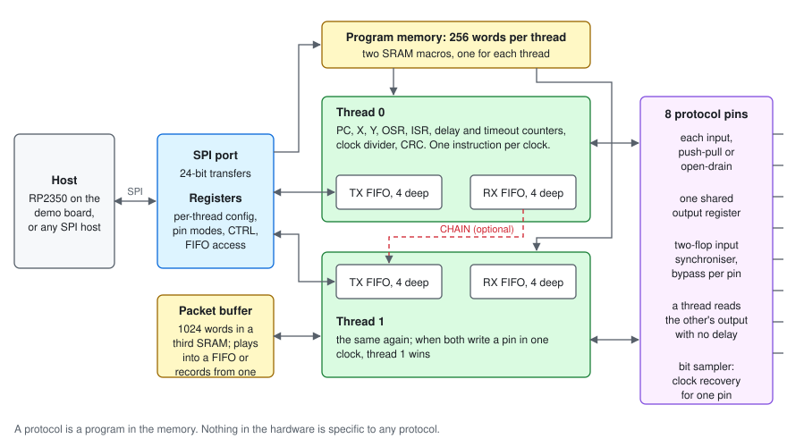
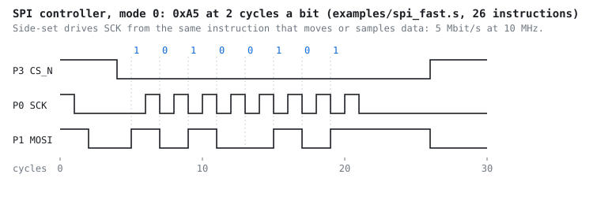

# Submission summary

For a reader with ten minutes. Every claim links to where it is
shown; [`design-and-verification.md`](design-and-verification.md) is the
full report.

## The claim: protocols are programs

A laid-out chip in 3D, with the reference model running firmware on it:
[`chip.html`](chip.html) (one self-contained file; download and open it, or
[view it here](https://htmlpreview.github.io/?https://github.com/tavelarocque/protocol-emulator/blob/main/docs/chip.html)).
It shows v1.4's layout; v2.0's, with the program memory in two SRAM macros,
has not been rendered yet.

The chip is a small CPU whose instructions read pins, write pins and count
clock cycles. A protocol is a program, loaded over SPI after fabrication;
the largest here is 63 instructions. Nothing in the hardware knows what
UART, SPI or I2C is.

The evidence that this is general is what happened after the hardware was
frozen at v1.4. Nine protocol engines were then added, each as firmware alone, with
no change to the RTL:

| Added after the freeze | What it needed from the hardware | Instructions |
|---|---|---|
| I2C target, with clock stretching and repeated START | nothing new | 63 |
| SPI device | nothing new | 23 |
| JTAG controller | nothing new | 11 |
| Arm SWD host | nothing new | 11 |
| Low-speed USB host, with clock recovery (a stretch goal) | nothing new; a 12 MHz clock | 49 |
| 1-Wire, with ROM search | nothing new | 25 |
| PS/2 host, receiving and sending on the two threads | nothing new | 11 + 21 |
| CAN transmitter and listen-only receiver, to 1 Mbit/s | nothing new | 19 + 27 |
| WS2812 LEDs | nothing new | 16 |

The last was a blind test. A programmer who had never seen the project (an
AI agent in a fresh session) was given only [`isa.md`](isa.md) and the
simulator, and wrote the driver in about five minutes. A hidden test, which
decodes the pin the way the LED's data sheet says an LED does, passed on the
first submission. The seven things the programmer found unclear in the
document are fixed. Task, notes and hidden test:
[`examples/ws2812`](../examples/ws2812).

v2.0 then changed one thing in the hardware, the program memory: 256 words
for each thread in an SRAM macro, where v1.4 had 64 words of flip-flops
shared by both. Every v1.4 program runs on it unchanged. Eleven more
engines followed, again as firmware alone: I2S, DMX512, Wiegand and NEC
infrared in both directions, RC-5 infrared, MDIO, DALI, PWM and a NES
gamepad. Nine further protocols needed no firmware at all, only framing in
the host driver on an engine the chip already had: MIDI, LIN, Modbus RTU,
and six devices on I2C and SPI. That makes 28 protocols, every one but
WS2812 with a test judged by something this project did not write.

## What it is, and what is different

Two threads run at once, each from its own 256-word program memory, over 8
protocol pins that are each input, push-pull or open-drain. Every
instruction takes one clock plus a 0 to 15 clock delay. Written in
Hardcaml; laid out on IHP 130 nm CMOS5L, 8x4 Tiny Tapeout tiles.

The instruction set follows the RP2040's PIO and departs from it where PIO
is weakest for emulating protocols:

- **A wait can time out**, jumping to a per-thread vector. A device that
  never answers cannot hang the chip; I2C clock stretching and UART framing
  recovery are built on it.
- **Open-drain is a pin mode**, in hardware, not emulated by toggling
  direction.
- **Threads can signal each other through a pin.** A thread reads another's
  output with no delay; the PS/2 receiver uses a spare pin to tell the
  transmitter a frame is under way.
- **Every 16-bit word is a defined instruction.** No program can put the
  chip in an undefined state.
- **CHAIN** feeds one thread's output FIFO into the other's input, so the
  I2C-to-SPI bridge runs with no host in the data path.
- **Any host can load it**: the port is plain SPI.

Each revision of the instruction set came from writing a protocol and
finding what was missing; [`firmware.md`](firmware.md) tells that story.

## What it runs

| Protocol | Role | Instructions |
|---|---|---|
| UART | TX and RX, full duplex on the two threads | 15 + 15 |
| SPI | controller (5 Mbit/s at 10 MHz) and device | 26, 23 |
| I2C | controller and target, clock stretching, timeouts | 25, 63 |
| I2C-to-SPI bridge | both threads, no host in the data path | 25 + 26 |
| JTAG and SWD | controller, host | 11, 11 |
| Low-speed USB | host, with clock recovery | 49 |
| 1-Wire | bus controller, ROM search | 25 |
| PS/2 | host, both directions | 11 + 21 |
| CAN | transmitter and listen-only receiver | 19 + 27 |
| WS2812 LEDs | driver | 16 |
| I2S | transmitter, 16-bit stereo | 11 |
| DMX512 | transmitter | 26 |
| Wiegand | transmitter and receiver | 17, 16 |
| NEC infrared | transmitter with its 38 kHz carrier; receiver | 25, 33 |
| RC-5 infrared | transmitter with its 36 kHz carrier | 37 |
| MDIO | controller, reads and writes | 7 |
| DALI | forward frame transmitter | 17 |
| PWM, RC servo | generator, exact to the cycle | 8 |
| NES gamepad | host | 7 |
| MIDI, Modbus RTU | on the UART transmitter | no new firmware |
| LIN | master frames, on the DMX512 transmitter | no new firmware |
| 24Cxx EEPROM, DS1307 clock, LM75 sensor | on the I2C controller | no new firmware |
| SPI NOR flash, WS2801 LEDs, MAX7219 | on the SPI controller | no new firmware |

Each is an assembly file in [`examples/`](../examples), generated from the
firmware the tests run. The toolchain is the assembler and `pe_sim`, which
runs a program on the reference model and prints the pins.

## Why to believe it works

1. **An executable specification.** A reference model with no dependency on
   the hardware; the RTL is compared with it every cycle over 400 random
   two-thread programs.
2. **Three formal proofs.** The whole chip's RTL, pins to pins, is proven
   equivalent to an independent specification (SAT, Z3). After every
   layout, the post-layout gate netlist is proven equal to the RTL (Yosys:
   every output pin, all 796 flip-flops and every pin of the two memories).
   And the memory those two proofs assume is proven equal to IHP's own
   model of the SRAM macro.
3. **Judges written by other people.** Every protocol except WS2812 is
   checked by something this project did not write. Device models:
   picosoc's SPI flash, cocotbext's I2C, SPI, UART and JTAG, usbhostslave's
   USB device, sockit_owm's 1-Wire slave. For SWD, PS/2, CAN and every
   protocol added on v2.0, the recorded pins go to sigrok's protocol
   decoders, 21 tests in all, 19 of them with a fault planted on the wire
   to show the decoder's verdict can change.
4. **Tests that are themselves tested.** 103 bugs are planted in the RTL,
   firmware, drivers, specifications and netlist, kept in the repository,
   and the build fails if any survives. Functional coverage also fails the
   build on any zero.
5. **The gates, not only the RTL.** All 49 chip-level tests pass on the
   post-layout netlist, with IHP's model of the SRAM in place of the macros.
6. **The software that will run on the board.** The MicroPython driver is
   tested unchanged in cocotb, and in MicroPython on an emulated demo
   board, where a real timing bug in the USB handshake was found and
   fixed, and where the driver was found too large to compile on the
   board's microcontroller and was split.

## Layout

| | |
|---|---|
| Tiles | 8x4 |
| Standard cells | 10,359, and two SRAM macros; 13.4% utilisation |
| Flip-flops | 796 |
| Clock target | 20 ns (50 MHz); the firmware here runs the chip at 10 to 12 MHz |
| Setup, slow corner | met, about 4 ns to spare between flip-flops |
| Hold, every corner | met |
| LVS, antenna | pass; Tiny Tapeout precheck (IHP's KLayout rule deck) passes |
| Layout time | 20 to 30 minutes |

The same RTL was also laid out at 25 ns and at 16 ns and met timing at
every corner both times; 20 ns keeps a margin. v1.4, with its program in
flip-flops, was 17,925 cells and met 25 ns. The comparison is in
[`metrics.md`](metrics.md).

## What is not shown

Stated here so nobody has to find it.

- **No silicon and no FPGA run yet.** Everything above is simulation, formal
  proof and an emulated board.
- **Signoff warnings, not yet explained.** The v2.0 layout has
  maximum-slew and maximum-capacitance warnings at all three corners.
  Setup and hold are met everywhere. The SRAM macros' pins are the
  suspect, and that is not confirmed ([`metrics.md`](metrics.md)).
- **50 MHz is static timing analysis only.** No test runs the chip above
  12 MHz.
- **The SRAM macro itself is trusted.** The proofs and the tests use IHP's
  behavioural model of it. That the silicon macro behaves as that model
  says is IHP's to guarantee.
- **USB is low speed, host only**, and needs a 12 MHz core clock.
- **CAN is not a full node.** It sends, arbitrates and listens, but does not
  acknowledge other nodes' frames or send error frames. On v1.4 the
  decoding that takes did not fit in the memory; on v2.0 there is room,
  and the firmware has not been written.
- **The I2C controller cannot send a repeated START.** It starts a
  transfer only after a STOP, so a device that insists on one between
  setting a register pointer and reading is out of reach.
- **Several of the v2.0 protocols transmit only:** I2S, DMX512, DALI,
  RC-5, MIDI, LIN and Modbus RTU. Wiegand and NEC infrared go both ways.
- **The blind firmware test used an AI agent, not a person.**
- More in section 7 of the report, "What is not covered".

## How AI tools were used

The project was built with an AI assistant throughout: RTL, firmware, tests
and documents, with the commits marked. Three uses are part of the method,
not only of the typing:

- **Coverage closure.** The assistant read the coverage report and wrote
  directed tests for the 16 rarely reached cases. It never judged them: the
  reference model did, every cycle, and a check rejected any test that
  missed its own target. One was rejected
  ([`coverage-closure.md`](coverage-closure.md)).
- **The blind firmware test** above, where not having seen the project was
  the point.
- **Planted bugs**, which test the tests.

What keeps one author's misreading from passing every layer: correctness
rests on artefacts written separately (the reference model, the formal
specifications), and on device models written by other people. Section 6 of
the report sets out the rules.

## Submission checklist

| Asked for | Where |
|---|---|
| RTL, tests, passing GDS and precheck | `hw/`, `sim/`, `test/`; the `gds` workflow |
| Architecture and instruction set | [`isa.md`](isa.md), [`info.md`](info.md), README |
| Assembler or toolchain, example programs | `model/asm.ml`, `bin/pe_sim.ml`, [`examples/`](../examples) |
| Verification write-up | [`design-and-verification.md`](design-and-verification.md) |
| Host and program loading | SPI port, [`info.md`](info.md); `host/protocol_emulator.py`, `host/more_protocols.py` |
| How AI tools were used | above, and section 6 of the report |

## Reproduce

`./reproduce.sh` runs all of the following and prints one line per claim.
`dune build && dune runtest` for the OCaml suite and the whole-chip proof;
`cd test && make` for cocotb. CI runs all of it, and the layout, on every
push. Details: "Running" in the [README](../README.md).
