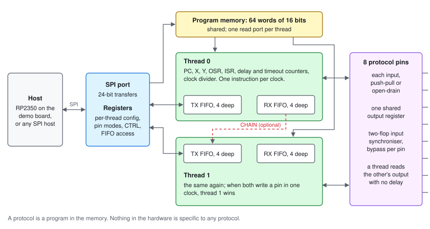
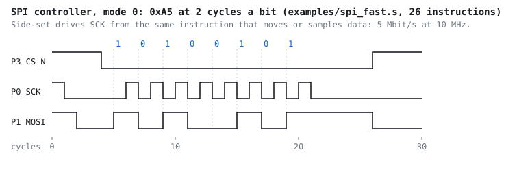

# Submission summary

For a reader with ten minutes. Every claim links to where it is
shown; [`design-and-verification.md`](design-and-verification.md) is the
full report.

## The claim: protocols are programs

The chip is a small CPU whose instructions read pins, write pins and count
clock cycles. A protocol is a program of at most 64 instructions, loaded
over SPI after fabrication. Nothing in the hardware knows what UART, SPI or
I2C is.

The evidence that this is general is what happened after the hardware was
frozen at v1.4. Nine protocol engines were then added, each as firmware alone, with
no change to the RTL:

| Added after the freeze | What it needed from the hardware | Instructions |
|---|---|---|
| I2C target, with clock stretching and repeated START | nothing new | 63 |
| SPI device | nothing new | 23 |
| JTAG controller | nothing new | 11 |
| Arm SWD host | nothing new | 11 |
| Low-speed USB host, with clock recovery (a stretch goal) | nothing new; a 12 MHz clock | 49 |
| 1-Wire, with ROM search | nothing new | 25 |
| PS/2 host, receiving and sending on the two threads | nothing new | 11 + 21 |
| CAN transmitter and listen-only receiver, to 1 Mbit/s | nothing new | 19 + 27 |
| WS2812 LEDs | nothing new | 16 |

The last was a blind test. A programmer who had never seen the project (an
AI agent in a fresh session) was given only [`isa.md`](isa.md) and the
simulator, and wrote the driver in about five minutes. A hidden test, which
decodes the pin the way the LED's data sheet says an LED does, passed on the
first submission. The seven things the programmer found unclear in the
document are fixed. Task, notes and hidden test:
[`examples/ws2812`](../examples/ws2812).

## What it is, and what is different

Two threads run at once from one 64-word program memory, over 8 protocol
pins that are each input, push-pull or open-drain. Every instruction takes
one clock plus a 0 to 15 clock delay. Written in Hardcaml; laid out on IHP
130 nm CMOS5L, 8x4 Tiny Tapeout tiles.

The instruction set follows the RP2040's PIO and departs from it where PIO
is weakest for emulating protocols:

- **A wait can time out**, jumping to a per-thread vector. A device that
  never answers cannot hang the chip; I2C clock stretching and UART framing
  recovery are built on it.
- **Open-drain is a pin mode**, in hardware, not emulated by toggling
  direction.
- **Threads can signal each other through a pin.** A thread reads another's
  output with no delay; the PS/2 receiver uses a spare pin to tell the
  transmitter a frame is under way.
- **Every 16-bit word is a defined instruction.** No program can put the
  chip in an undefined state.
- **CHAIN** feeds one thread's output FIFO into the other's input, so the
  I2C-to-SPI bridge runs with no host in the data path.
- **Any host can load it**: the port is plain SPI.

Each revision of the instruction set came from writing a protocol and
finding what was missing; the README's "Architecture" tells that story.

## What it runs

| Protocol | Role | Instructions (of 64) |
|---|---|---|
| UART | TX and RX, full duplex on the two threads | 15 + 15 |
| SPI | controller (5 Mbit/s at 10 MHz) and device | 26, 23 |
| I2C | controller and target, clock stretching, timeouts | 25, 63 |
| I2C-to-SPI bridge | both threads, no host in the data path | 25 + 26 |
| JTAG, SWD, low-speed USB, 1-Wire, PS/2, CAN, WS2812 | as above | 11, 11, 49, 25, 32, 46, 16 |

Each is an assembly file in [`examples/`](../examples), generated from the
firmware the tests run. The toolchain is the assembler and `pe_sim`, which
runs a program on the reference model and prints the pins.

## Why to believe it works

1. **An executable specification.** A reference model with no dependency on
   the hardware; the RTL is compared with it every cycle over 400 random
   two-thread programs.
2. **Two formal proofs.** The whole chip's RTL, pins to pins, is proven
   equivalent to an independent specification (SAT, Z3). After every
   layout, the post-layout gate netlist is proven equal to the RTL (Yosys,
   all 1,796 flip-flops).
3. **Device models written by other people.** Every protocol except SWD,
   PS/2 and CAN is checked against at least one third-party model: picosoc's SPI flash,
   cocotbext's I2C, SPI, UART and JTAG, usbhostslave's USB device,
   sockit_owm's 1-Wire slave.
4. **Tests that are themselves tested.** 86 bugs are planted in the RTL,
   firmware, drivers, specifications and netlist, kept in the repository,
   and the build fails if any survives. Functional coverage also fails the
   build on any zero.
5. **The gates, not only the RTL.** All 28 chip-level tests pass on the
   post-layout netlist.
6. **The software that will run on the board.** The MicroPython driver is
   tested unchanged in cocotb, and in MicroPython on an emulated demo
   board, where a real timing bug in the USB
   handshake was found and fixed.

## Layout

| | |
|---|---|
| Tiles | 8x4 |
| Standard cells | 17,925, 20.8% utilisation |
| Clock target | 25 ns (40 MHz); the chip runs at 10 to 12 MHz |
| Setup slack, slow corner | +6.85 ns |
| Hold slack, worst corner | +0.12 ns |
| DRC, LVS, antenna | 0 violations; Tiny Tapeout precheck passes |

## What is not shown

Stated here so nobody has to find it.

- **No silicon and no FPGA run yet.** Everything above is simulation, formal
  proof and an emulated board.
- **One signoff warning.** At the slow corner only (1.08 V, 125 C), 36 pins
  on 9 nets exceed the cell library's slew limit, by at most 33%. Two
  repairs were tried and did not clear it; see "Metrics" in the
  [README](../README.md).
- **USB is low speed, host only**, and needs a 12 MHz core clock.
- **CAN is not a full node.** It sends, arbitrates and listens, but does not
  acknowledge other nodes' frames or send error frames: decoding a frame as
  it arrives does not fit beside the rest in 64 instructions.
- **The blind firmware test used an AI agent, not a person.**
- More in section 7 of the report, "What is not covered".

## How AI tools were used

The project was built with an AI assistant throughout: RTL, firmware, tests
and documents, with the commits marked. Three uses are part of the method,
not only of the typing:

- **Coverage closure.** The assistant read the coverage report and wrote
  directed tests for the 16 rarely reached cases. It never judged them: the
  reference model did, every cycle, and a check rejected any test that
  missed its own target. One was rejected
  ([`coverage-closure.md`](coverage-closure.md)).
- **The blind firmware test** above, where not having seen the project was
  the point.
- **Planted bugs**, which test the tests.

What keeps one author's misreading from passing every layer: correctness
rests on artefacts written separately (the reference model, the formal
specifications), and on device models written by other people. Section 6 of
the report sets out the rules.

## Submission checklist

| Asked for | Where |
|---|---|
| RTL, tests, passing GDS and precheck | `hw/`, `sim/`, `test/`; the `gds` workflow |
| Architecture and instruction set | [`isa.md`](isa.md), [`info.md`](info.md), README |
| Assembler or toolchain, example programs | `model/asm.ml`, `bin/pe_sim.ml`, [`examples/`](../examples) |
| Verification write-up | [`design-and-verification.md`](design-and-verification.md) |
| Host and program loading | SPI port, [`info.md`](info.md); `host/protocol_emulator.py` |
| How AI tools were used | above, and section 6 of the report |

## Reproduce

`dune build && dune runtest` for the OCaml suite and the whole-chip proof;
`cd test && make` for cocotb. CI runs all of it, and the layout, on every
push. Details: "Running" in the [README](../README.md).
